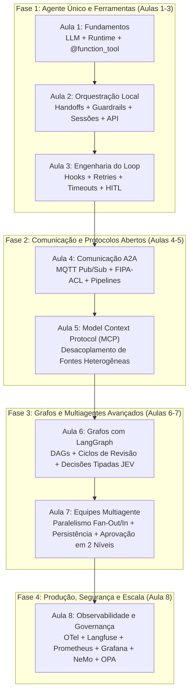

# Sistemas Multiagentes com IA — Resumo e Guia Geral das Aulas

Este repositório contém o ecossistema prático e o referencial teórico da disciplina **Sistemas Multiagentes com IA** (Pós-Graduação — IBMEC). O projeto percorre toda a jornada de engenharia de software para agentes autônomos: desde os blocos fundamentais com o SDK `openai-agents`, passando pela comunicação assíncrona entre processos (**MQTT/A2A**) e protocolos abertos de integração de dados (**MCP**), até a orquestração determinística em grafos com **LangGraph**, observabilidade em tempo real (**OpenTelemetry, Langfuse, Prometheus/Grafana**) e defesas de segurança (**NeMo Guardrails, OPA, Auditoria**).

---

## 🏛️ Estrutura Global do Repositório

```text
11_Sistem_MultiAgentes/
  ├── provedor.py            # Central multi-provedor (Zen, Ollama, OpenAI) com fallback automático
  ├── requirements.txt       # Dependências consolidadas do projeto (Aulas 1 a 8)
  ├── .env.example           # Modelo unificado de variáveis de ambiente
  ├── docs/                  # E-pubs, apostilas, mapas conceituais e status de sincronização
  ├── aula1/                 # Fundamentos: Diferença LLM x Agente, Runner, @function_tool, Provedores
  ├── aula2/                 # Orquestração: Handoff, Agente-como-Tool, Guardrails, Sessão, Streaming, FastAPI
  ├── aula3/                 # Engenharia de Loops: RunHooks, AgentHooks, Retries, Idempotência, HITL
  ├── aula4/                 # Comunicação A2A: Síncrono x Assíncrono, MQTT Pub/Sub, FIPA-ACL, Pipelines
  ├── aula5/                 # Model Context Protocol (MCP): Servidores FastMCP, Postgres, SQL Server, Docker
  ├── aula6/                 # Grafos com LangGraph: DAGs, Ciclos, Condicionais, Desafios (Cofre, JEV, MCP)
  ├── aula7/                 # Equipes Multiagente: Especialistas, Paralelismo Fan-Out/In, SQLiteSaver, HITL
  ├── aula8/                 # Observabilidade e Segurança: OTel, Langfuse, Prometheus, Grafana, NeMo, OPA
  └── exercicios_resolvidos/ # Banco de soluções e exercícios guiados (Aulas 1 a 4)
```

---

## 🗺️ Mapa Evolutivo da Arquitetura do Curso



---

## 📚 Visão Geral por Aula

### [Aula 1 — Fundamentos de Agentes e Ferramentas](file:///home/phmcasimiro/Documentos/pos_graduacao/11_Sistem_MultiAgentes/aula1/README.md)
- **Conceito central**: Diferença entre LLM (função probabilística estática e sem memória) e Agente (sistema com estado, objetivos, laço de execução e capacidade de atuar no ambiente).
- **Provedor Desacoplado**: O arquivo [`provedor.py`](file:///home/phmcasimiro/Documentos/pos_graduacao/11_Sistem_MultiAgentes/provedor.py) implementa a abstração multi-provedor (OpenCode Zen, Ollama local e OpenAI oficial) com recuo automático para modelos locais se a API remota oscilar.
- **Tool Calling**: A anotação `@function_tool` transforma código Python em especificação JSON Schema consumível pelo modelo. Tratamento de exceções e parsing rigoroso em ferramentas públicas como ViaCEP (`agente5.py`) e Receita Federal/BrasilAPI com conformidade LGPD (`agente6.py`).
- **Contratos Pydantic**: Validação de saída em tempo de compilação via `output_type`.

### [Aula 2 — Orquestração, Guardrails e Persistência](file:///home/phmcasimiro/Documentos/pos_graduacao/11_Sistem_MultiAgentes/aula2/README.md)
- **Handoffs vs Agente como Ferramenta**: O `handoffs=[...]` transfere a soberania do turno para outro especialista (`transfer_to_<nome>`), enquanto `as_tool()` mantém o orquestrador no controle integrando o resultado como dado.
- **Guardrails de Segurança**: Implementação de travas determinísticas sem custo de tokens em Python puro (`agente_guardrail_puro.py`) com interrupção por *tripwire*, e guardrails neurais (`agente_guardrail.py`).
- **Memória Conversacional**: Persistência entre turnos e isolamento criptográfico/lógico de conversas através de `SQLiteSession` (`conversa_do_molina.db`, `coleta.db`).
- **Produção e APIs**: Exposição do orquestrador via FastAPI (`main.py`) com streaming de tokens e auditoria via `resultado.last_agent`.

### [Aula 3 — Engenharia do Agent Loop](file:///home/phmcasimiro/Documentos/pos_graduacao/11_Sistem_MultiAgentes/aula3/README.md)
- **Anatomia do Loop**: O ciclo interno do `Runner` — observação, raciocínio ReAct, despacho de ações e reavaliação.
- **Hooks e Telemetria**: Diferença fundamental entre `RunHooks` (ciclo da execução global) e `AgentHooks` (ciclo do agente ativo), com interceptação assíncrona (`on_llm_start`, `on_tool_start`, `on_agent_start`).
- **Condições de Parada e Resiliência**: Limites de turnos (`max_turns`), timeouts externos via `asyncio`, retries automáticos com backoff exponencial e prevenção de duplicidade através de garantias de idempotência.
- **Human-in-the-Loop (HITL)**: Interrupção controlada via `needs_approval` exigindo intervenção humana para ações de alto impacto.

### [Aula 4 — Comunicação Agente-a-Agente (A2A)](file:///home/phmcasimiro/Documentos/pos_graduacao/11_Sistem_MultiAgentes/aula4/README.md)
- **Síncrono × Assíncrono**: Transição de acoplamento temporal no mesmo processo (Handoff local) para mensageria desacoplada e distribuída fora de processo (MQTT Pub/Sub).
- **Topologias MQTT**: Publicação, assinatura, tópicos dinâmicos (`pcdf/demo`), fan-out para agentes analíticos e arquitetura Request/Reply assíncrona sobre mensageria.
- **Protocolos Padronizados**: Semântica FIPA-ACL (performatives como `REQUEST`, `INFORM`, `PROPOSE`) e pipelines encadeados de processamento de ocorrências policiais (Coletor $\rightarrow$ Triagem $\rightarrow$ Jurídico).

### [Aula 5 — Model Context Protocol (MCP)](file:///home/phmcasimiro/Documentos/pos_graduacao/11_Sistem_MultiAgentes/aula5/README.md)
- **Protocolo Aberto**: Desacoplamento $N \times M$ entre agentes e fontes heterogêneas utilizando o padrão da Anthropic/Linux Foundation.
- **Servidores FastMCP**: Implementação de ferramentas expostas por servidores de contexto em processos e contêineres dedicados.
- **Fontes Heterogêneas**: Integração com bases reais de Segurança Pública — PostgreSQL (20.000 ocorrências), SQL Server (viaturas e unidades) e Google Sheets/CSV (eventos públicos).
- **Infraestrutura**: Ambientes isolados via Docker Compose com bancos relacionais prontos para auditoria.

### [Aula 6 — Modelagem em Grafos de Decisão (LangGraph)](file:///home/phmcasimiro/Documentos/pos_graduacao/11_Sistem_MultiAgentes/aula6/README.md)
- **Transição para Grafos de Estado**: Modelagem de processos complexos onde o estado é explícito (`TypedDict`), com nós executores e arestas direcionadas.
- **Topologias de Controle**: Fluxos lineares, DAGs com ramificações paralelas, grafos cíclicos com nós de validação/revisão e condições rígidas de parada.
- **Decisões Tipadas com JEV**: Aplicação da máxima *"LLM para escrever, JEV para decidir"* — decisões guiadas por probabilidades numéricas e confiança estatística sem ambiguidade textual.
- **Servidor MCP de Grafos**: Exposição do diagrama de arquitetura do sistema diretamente via ferramentas MCP stdio.

### [Aula 7 — Orquestração Multiagente Avançada com LangGraph](file:///home/phmcasimiro/Documentos/pos_graduacao/11_Sistem_MultiAgentes/aula7/README.md)
- **Equipes Especializadas**: Agentes Investigador, Jurídico, Risco e Redator colaborando sobre o mesmo estado.
- **Paralelismo de Grafos**: Execução paralela (Fan-Out `juridico` e `risco`) e barreira de sincronização (Fan-In `consolidar`).
- **Aprovação em Cascata (Dois Níveis)**: Pausa e retomada no grafo via `interrupt()`, implementando aprovação pelo Gestor e, sob alto risco, aprovação pelo Diretor Geral.
- **Persistência de Checkpoints**: Retomada resiliente e rastreabilidade temporal com `SqliteSaver` / `MemorySaver`.

### [Aula 8 — Auto-scaling, Observabilidade e Governança](file:///home/phmcasimiro/Documentos/pos_graduacao/11_Sistem_MultiAgentes/aula8/README.md)
- **Observabilidade Completa**: Padrão OpenTelemetry (instrumentação agnóstica), traces e custos no Langfuse Cloud, métricas em tempo real no Prometheus e dashboards no Grafana.
- **Segurança de Entrada e Saída**: Prevenção contra Prompt Injection com guardrails de entrada (NeMo Guardrails), e validação de schema e formato com guardrails de saída.
- **Governança com OPA (Open Policy Agent)**: Separação entre decisão do modelo e autorização institucional — políticas em código (`.rego`) aplicando o princípio do menor privilégio (*Least Privilege*).
- **Auditoria Estruturada**: Geração de logs imutáveis em JSONL contendo o ciclo completo de autorização, ferramentas acionadas e identificador único (`trace_id`).

---

## 🚀 Como Executar

### 1. Preparação do Ambiente
```bash
# Clone ou acesse a raiz do projeto
cd 11_Sistem_MultiAgentes

# Ative o ambiente virtual consolidado
source venv/bin/activate

# Configure as variáveis de ambiente
cp .env.example .env
# Edite as variáveis conforme seu provedor (zen, ollama ou openai)
```

### 2. Exemplos das Aulas 1 a 5 (SDK `openai-agents`)
```bash
# Aula 1 — Consulta de endereço via ferramenta com tratamento de erro:
python -m aula1.agente5

# Aula 2 — Triagem e Handoff com linha de comando:
python -m aula2.agente_handoff "Gostaria de saber sobre a Revolução Francesa"

# Aula 2 — Iniciar a API REST do laboratório:
uvicorn aula2.main:app --reload

# Aula 3 — Executar agente com observabilidade de hooks:
python -m aula3.agente_hook1

# Aula 4 — Comunicação MQTT (Pub/Sub):
python aula4/ex4_mqtt_pub.py
python aula4/ex5_mqtt_sub.py

# Aula 5 — Subir bancos e servidores MCP:
cd aula5 && docker compose up -d postgres mssql && cd ..
```

### 3. Exemplos das Aulas 6 e 7 (LangGraph)
```bash
# Aula 6 — Validar todos os pontos do Desafio 1 (com Mock offline):
PROVEDOR=mock python aula6/desafio/conferir.py

# Aula 6 — Validar o Desafio 3 (Decisões Tipadas JEV):
python aula6/desafio3/conferir.py

# Aula 6 — Executar testes do Exercício Guiado (MCP Server de Grafos):
python -m unittest aula6.exercicio_guiado.test_guiado -v

# Aula 7 — Executar desafio multiagente com persistência:
python aula7/desafio/main.py
```

### 4. Exemplos da Aula 8 (Observabilidade, Segurança e Docker)
```bash
# Subir Prometheus, Grafana e OPA:
cd aula8/docker && docker compose up -d && cd ../..

# Testar agente com tracing OpenTelemetry e Langfuse:
python aula8/exemplos/03_observabilidade/1_codigo_pronto/main.py

# Testar defesa contra Excessive Agency e privilégio mínimo:
python aula8/exemplos/06_excessive_agency/1_codigo_pronto/main.py
```
