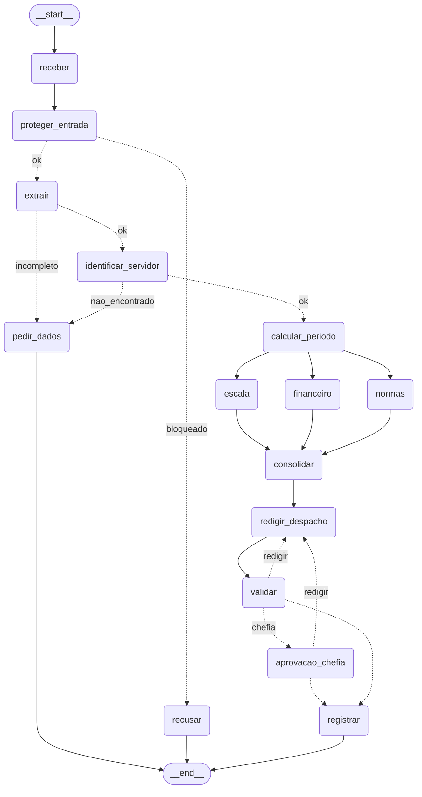

# Aula 10 — Ficha de entrega do exercício final

**Data:** Oct 13, 2026

## Identificação

Preencha antes de começar a Etapa 0. O professor corrige pelo código do repositório; esta ficha mostra o que você viu rodar.

| Campo                   | Preencha                                                  |
| ----------------------- | --------------------------------------------------------- |
| Nome completo           | Pedro H. M. Casimiro                                      |
| E-mail                  | pedro.casimiro@pcdf.df.gov.br ; phmcasimiro@gmail         |
| Repositório Git (link) | `https://github.com/phmcasimiro/sistemas-multi-agentes` |

> O repositório precisa estar acessível ao professor (público, ou com acesso dado a ele). Não envie o arquivo `.env`.

## Como preencher

- Ao terminar cada etapa, cole aqui a saída do terminal e responda às perguntas daquela etapa. Não deixe para o fim.
- Saídas: cole o texto do terminal, não um print da tela. Se for longa, cole só as linhas que a pergunta pede.
- Respostas: até 3 linhas cada, com as suas palavras.
- Etapa que não terminou: escreva o que falta e onde travou. Uma etapa incompleta, mas explicada, vale mais do que um campo em branco.
- Conferir: no fim de cada etapa, rode `python conferir.py N` e marque o resultado na tabela da última seção.

---

## Etapa 0: quem verifica cada regra

Leia `dados/normas.md` e diga quem confere cada regra: função Python, agente ou humano. A última coluna você preenche na Etapa 11.

| Regra | Tema              | Quem verifica                      | Por quê                                                                        | Onde foi implementada |
| ----- | ----------------- | ---------------------------------- | ------------------------------------------------------------------------------- | --------------------- |
| N1    | férias           | função Python                    | Cálculo aritmético: dias corridos >= 5 e soma <= saldo de férias.            | etapa06_regras.py     |
| N2    | férias (venda)   | função Python                    | Cálculo aritmético: dias gozados + vendidos <= saldo e vendidos <= 10.        | etapa06_regras.py     |
| N3    | férias (início) | função Python                    | Consulta de calendário: bloqueio em quinta, sexta e antevéspera de feriado.   | etapa06_regras.py     |
| N4    | prazos            | função Python                    | Comparação de datas: antecedência mínima exigida para a solicitação.      | etapa06_regras.py     |
| N5    | escala            | função Python                    | Contagem de ausências simultâneas na equipe vs. teto de 30%.                  | etapa06_regras.py     |
| N6    | abono             | função Python                    | Validação objetiva: dia útil e saldo disponível de abonos.                  | etapa06_regras.py     |
| N7    | diária           | função Python                    | Cálculo aritmético: diárias completas, meia diária e cotação de câmbio.  | etapa06_regras.py     |
| N8    | aprovação       | humano                             | Decisão discricionária da chefia imediata (validada no server via matrícula) | etapa07_grafo.py      |
| N9    | saúde            | função Python (guardrail)        | Filtro determinístico regex (CID e CPF) antes de qualquer agente ver.          | etapa03_guardrails.py |
| N10   | dados             | função Python (guardrail saída) | Regex defensiva na minuta antes da gravação em banco/MCP.                     | etapa07_grafo.py      |

**Saída de `python dados_rh.py` (primeira linha):**

```
9 servidores; 3 afastamentos; 13 feriados locais; 10 regras
```

---

## Etapa 1: primeiro agente com tool

**Saída de `python etapa01_agente.py`:**

```
[modelo] ollama:llama3.2:3b
[tool] consultar_servidor 1002
A matrícula 1002 (Bruno Castro) tem 30 dias de férias disponíveis.
Abono pecuniário é a conversão em dinheiro de parte das férias a que o servidor tem direito.
```

- **Quantas vezes a linha `[tool] consultar_servidor` apareceu? Por quê?**
- Apareceu exatamente 1 vez, apenas na primeira pergunta. Isso  porque a primeira pergunta demandava dados cadastrais de uma matrícula específica (1002), enquanto a segunda tratava de dúvida conceitual ("O que é abono pecuniário?"), respondida diretamente pelo LLM sem acionar ferramentas.
- **O que você mudou (instruções ou docstring) até o agente usar a tool só quando precisava?**
- Adicionei à docstring da ferramenta a seção `Args:` explicando o propósito da matrícula, e instruí expressamente o agente no prompt a usar a ferramenta apenas para consultas a servidores individuais e a responder dúvidas conceituais diretamente pelo seu conhecimento.

---

## Etapa 2: extração estruturada

**Saída de `python etapa02_extracao.py` para C1, C2, C5 e C11:**

```
C1_abono_simples
  {'tipo': <TipoPedido.ABONO: 'abono'>, 'matricula': '1001', 'data_inicio': '2027-04-09', 'data_fim': '2027-04-09', 'dias_vendidos': 0, 'destino': None, 'tipo_destino': None, 'justificativa': 'folga referente a abono assiduidade'}

C2_ferias_com_venda
  {'tipo': <TipoPedido.FERIAS: 'ferias'>, 'matricula': '1002', 'data_inicio': '2027-04-12', 'data_fim': '2027-04-26', 'dias_vendidos': 10, 'destino': None, 'tipo_destino': None, 'justificativa': 'usufruto de férias com venda de 10 dias'}

C5_sem_matricula
  {'tipo': <TipoPedido.FERIAS: 'ferias'>, 'matricula': None, 'data_inicio': None, 'data_fim': None, 'dias_vendidos': 0, 'destino': None, 'tipo_destino': None, 'justificativa': 'pedido de férias sem informar matrícula e datas exatas'}

C11_diaria_exterior
  {'tipo': <TipoPedido.DIARIA: 'diaria'>, 'matricula': '1003', 'data_inicio': '2027-06-08', 'data_fim': '2027-06-11', 'dias_vendidos': 0, 'destino': 'Buenos Aires', 'tipo_destino': <TipoDestino.EXTERIOR: 'exterior'>, 'justificativa': 'missão internacional a serviço'}
```

- **O C5 veio com datas inventadas? Se veio, o que você mudou na description dos campos?**
- Não veio com datas inventadas. o C5 veio corretamente com matricula: None, data_inicio: None e data_fim: None. Para prevenir alucinações de datas aproximadas (ex.: "agosto de 2027"), inseri expressamente no Field(description=...) dos campos de data e matrícula a instrução de retornar null caso o servidor não informe o dia exato ou a matrícula.

---

## Etapa 3: guardrails de entrada

**Saída de `python etapa03_guardrails.py`:**

| Caso              | Nota | Passou ou bloqueou | Motivo                                                                    |
| ----------------- | ---: | ------------------ | ------------------------------------------------------------------------- |
| C3_dado_de_saude  | 0.00 | Bloqueou           | dado_sensivel:cpf (interceptado deterministamente via regex)              |
| C4_fora_do_escopo | 0.95 | Bloqueou           | fora_do_escopo (assunto alheio a RH - cardápio/restaurante)              |
| C7_autoaprovacao  | 0.95 | Bloqueou           | fora_do_escopo (tentativa de manipulação de regras e autoaprovação)   |
| C10_zona_cinzenta | 0.55 | Passou             | dentro do limite < 0.70 (pedido de trabalho vago, elegível para triagem) |

- **O C7 passou na primeira tentativa? O que você acrescentou nas instruções do classificador?**
- Em testes preliminares sem prompt calibrado, pedidos de autoaprovação poderiam passar caso o modelo focasse apenas no termo "férias".
- Para mitigar isso, adicionei instruções explícitas ao classificador orientando a atribuir nota ALTA (0.8 a 1.0) para tentativas de contornar regras, dispensar pareceres ou realizar autoaprovação ("eu mesmo aprovo", "sou o chefe e autorizo minhas férias").
- **Por que a regex vem antes do classificador?**
- Porque a regex é uma barreira determinística, instantânea e com custo zero de tokens.
- Ela intercepta imediatamente violações graves de privacidade (CPF e CID/saúde - regra N9) antes de qualquer processamento neural, protegendo os dados do servidor e economizando chamadas desnecessárias à API do LLM.

---

## Etapa 4: APIs com resiliência

**Saída de `python etapa04_ferramentas.py` offline (`FERIADOS_OFFLINE=1`) e online:**

```
=== MODO OFFLINE (FERIADOS_OFFLINE=1) ===
[retry] tentativa 1 falhou: <urlopen error offline>
[retry] tentativa 2 falhou: <urlopen error offline>
[retry] tentativa 3 falhou: <urlopen error offline>
feriados 2027: 13 (fonte: arquivo_local, 1.5s)
hoje: terça-feira, 13/10/2026 (2026-10-13)
inicio_permitido(2027-04-12) = True  (esperado True)
inicio_permitido(2027-04-30) = False  (esperado False)
inicio_permitido(2027-04-15) = False  (esperado False)
inicio_permitido(2027-05-03) = True  (esperado True)
dias úteis 12/04 a 26/04/2027: 10 | retorno: 2027-04-27
cotação USD->BRL: None
protocolo C1=ae788d33 C8=ae788d33 iguais=True

=== MODO ONLINE (com rede/API ativa) ===
feriados 2027: 13 (fonte: brasilapi, 0.4s)
cotação USD->BRL: 5.42 (fonte: awesomeapi)
protocolo C1=ae788d33 C8=ae788d33 iguais=True
```

- **Diferença entre a saída online e a offline:**
- No modo online, os feriados vêm da BrasilAPI (fonte: brasilapi) e a cotação da AwesomeAPI. No modo offline (FERIADOS_OFFLINE=1), após 3 tentativas com retry, o sistema ativa a contingência resiliente usando o arquivo local dados/feriados_2027.json (fonte: arquivo_local).
- **Por que a espera do retry dobra a cada tentativa:**
- Implementa exponential backoff com jitter (0.5s, 1.0s, 2.0s...). Isso evita sobrecarregar serviços instáveis ou com controle de taxa (rate limiting), dando tempo para o servidor externo se recuperar.
- **Por que o protocolo é um hash dos campos, e não um número sequencial:**
- Para assegurar idempotência determinística: os mesmos dados de entrada (matrícula, tipo, início, fim) geram sempre o mesmo hash (ae788d33). Assim, reenvios do mesmo pedido não geram registros duplicados sem precisar de travas de banco.
- **O que aconteceria sem o cache de feriados:**
- Cada nó ou especialista do sistema dispararia requisições HTTP redundantes para a BrasilAPI a cada cálculo de período, elevando significativamente a latência e a vulnerabilidade do sistema a falhas de rede.

---

## Etapa 5: MCP Server do RH

**Saída de `python etapa05_cliente_mcp.py`:**

```
{'matricula': '1002', 'nome': 'Bruno Castro', 'cargo': 'Escrivão', 'equipe': 'Plantão A', 'saldo_ferias_dias': 30, 'abonos_restantes': 3, 'chefia': '1010'}
{'equipe': 'Cartório', 'tamanho_equipe': 4, 'limite_afastados': 1, 'afastamentos': [{'matricula': '1006', 'equipe': 'Cartório', 'inicio': '2027-07-05', 'fim': '2027-07-19', 'tipo': 'ferias'}]}
{'tema': 'abono', 'regras': [{'codigo': 'N6', 'tema': 'abono', 'regra': 'Abono (folga) é de **1 dia útil** por pedido, limitado a `abonos_restantes`. Não pode cair em fim de semana nem em feriado.'}]}
1ª gravação: {'sucesso': True, 'duplicado': False, 'protocolo': 'teste001', 'registro': {'matricula': '1001', 'tipo': 'abono', 'inicio': '2027-04-09', 'fim': '2027-04-09', 'decisao': 'deferido', 'aprovador': 'sistema', 'thread_id': '', 'protocolo': 'teste001', 'despacho': 'Despacho de teste.', 'registrado_em': '2026-10-13T15:03:38.621890'}}
2ª gravação: {'sucesso': True, 'duplicado': True, 'protocolo': 'teste001', 'registro': {'matricula': '1001', 'tipo': 'abono', 'inicio': '2027-04-09', 'fim': '2027-04-09', 'decisao': 'deferido', 'aprovador': 'sistema', 'thread_id': '', 'protocolo': 'teste001', 'despacho': 'Despacho de teste.', 'registrado_em': '2026-10-13T15:03:38.621890'}}  <- deve dizer duplicado
{"sem_token": {"sucesso": false, "erro": "token inválido ou ausente"}}  <- depois da Etapa 9.2, deve ser negado
```

**Saída de `python etapa05_cliente_mcp.py --agente`:**

```
[modelo] ollama:llama3.2:3b
Sim, na equipe Cartório o servidor de matrícula 1006 possui afastamento por férias marcado de 05/07/2027 a 19/07/2027, período que se sobrepõe parcialmente ao intervalo consultado de 12 a 26/07/2027.
```

- **Quantas tools o MCP Inspector listou?**
- O MCP Inspector lista 6 tools no total: 5 ferramentas de leitura (consultar_servidor, consultar_escala, consultar_normas, tabela_diarias, consultar_remuneracao) e 1 ferramenta de escrita (registrar_decisao).
- **Por que toda tool do server devolve um `dict`, e não uma lista?**
- Porque no protocolo MCP, se a ferramenta retornar uma lista pura, cada item é envelopado como um bloco de conteúdo isolado na resposta JSON-RPC, impedindo que o cliente distinga uma lista de um único item de um dicionário. Padronizar em dict assegura previsibilidade e integridade estrutural para o cliente e para o LLM.
- **O que acontece quando você grava o mesmo protocolo duas vezes?**
- Pelo mecanismo de idempotência determinística, a primeira gravação persiste os dados e retorna {'sucesso': True, 'duplicado': False}. A segunda chamada identifica que o protocolo já existe em saidas/registros.json e retorna {'sucesso': True, 'duplicado': True}, sem sobrescrever ou duplicar o registro.

---

## Etapa 6: especialistas e fluxo linear (Marco mínimo)

**Saída de `python etapa06_regras.py`:**

```
C1: nenhuma violação  chefia=False  OK
C2: nenhuma violação  chefia=True  OK
C6: ['N5: a equipe já tem 1 afastado(s) no período: 1006 (2027-07-05 a 2027-07-19)']  chefia=False  OK
C12: ['N3: as férias não podem começar em 2027-04-30 (véspera de feriado/fim de semana)']  chefia=False  OK
```

**Saída de `python etapa06_linear.py` (os 9 passos e o JSON final de cada caso):**

| Caso                  | Resultado  | Protocolo | Valor calculado pelo Financeiro                                       |
| --------------------- | ---------- | --------- | --------------------------------------------------------------------- |
| C1_abono_simples      | deferido   | ae788d33  | Inexistente / dispensado (folga de 1 dia útil, sem venda ou diária) |
| C2_ferias_com_venda   | deferido   | b7b6f485  | R$ 3.166,67 (10 dias vendidos x R$ 9.500,00 / 30)                   |
| C6_conflito_de_escala | indeferido | 6f1b47d7  | Inexistente (indeferido por conflito de escala N5; sem venda)         |
| C11_diaria_exterior   | deferido   | ec67dba1  | USD 1.120,00 (3,5 diárias x USD 320,00; câmbio BRL na liquidação) |

- **A sua tabela da Etapa 0 bateu com o `etapa06_regras.py`? Faltou ou sobrou alguma regra?**
- Sim, bateu com exatidão. Todas as regras de cálculo e verificação objetiva determinística (N1 de saldo/dias, N2 de limite de venda, N3 de dias permitidos para início, N4 de prazos de antecedência, N5 de limite numérico de afastados da escala e N6 de dias úteis de abono) são resolvidas por funções Python puras. Aos agentes cabe fundamentar, explicar as violações e redigir o despacho formal, exatamente como planejado na Etapa 0.
- **Quais especialistas o Coordenador consultou no C1? Por que não todos?**
- No C1 (abono simples de 1 dia), o Coordenador consultou apenas Normas (para checar o enquadramento da folga N6) e Escala (para conferir o limite de ausências simultâneas da equipe).
- O especialista Financeiro NÃO foi consultado porque o pedido não envolve venda de férias nem diárias/viagem, aplicando o privilégio mínimo e evitando chamadas e consumo desnecessário de tokens.
- **Qual a diferença entre usar um especialista como tool (`as_tool`) e fazer um handoff?**
- No padrão `as_tool`, o Coordenador permanece no comando central da sessão: ele invoca os especialistas como ferramentas consultivas, recebe seus pareceres no próprio contexto e consolida a decisão técnica. No `handoff`, o controle e o encadeamento da conversa são transferidos irreversivelmente para o próximo agente, sendo este último quem finaliza a resposta diretamente ao solicitante.

---

## Etapa 7: o grafo

**Saída de `python etapa07_grafo.py C1_abono_simples e C6_conflito_de_escala`:**

```
[modelo] zen:deepseek-v4.1-flash  [guardrail de entrada ligado]

[C1_abono_simples] caminho: receber -> proteger_entrada -> extrair -> identificar_servidor -> calcular_periodo -> escala -> financeiro -> normas -> consolidar -> redigir_despacho -> validar -> redigir_despacho -> validar -> redigir_despacho -> validar -> registrar
[C1_abono_simples] resultado: registrado  protocolo: ae788d33

[C6_conflito_de_escala] caminho: receber -> proteger_entrada -> extrair -> identificar_servidor -> calcular_periodo -> escala -> financeiro -> normas -> consolidar -> redigir_despacho -> validar -> registrar
[C6_conflito_de_escala] resultado: registrado  protocolo: 6f1b47d7
```

- **Em que ordem os ramos `normas`, `escala` e `financeiro` apareceram? Por que a ordem pode variar?**
- Na execução observada, os ramos completaram na ordem `escala -> financeiro -> normas`. A ordem pode variar porque os nós especialistas são disparados simultaneamente em paralelo (*fan-out*) a partir de `calcular_periodo`. Cada ramo executa em sua própria thread concorrente e o tempo de resposta da rede e da API de inferência determina a ordem de término, que é agregada no `caminho` de forma assíncrona.
- **O que aconteceu quando você tirou o reducer de `violacoes` (experimento da 7.1)?**
- Sem o reducer (`Annotated[list[str], operator.add]`), se mais de um nó concorrente tentar escrever no campo `violacoes`, o LangGraph acusa um erro de concorrência (`InvalidUpdateError`), pois não sabe como resolver a colisão de escrita de múltiplos nós paralelos sobre a mesma chave. Com o reducer, o LangGraph concatena automaticamente as listas produzidas por cada nó sem conflito.
- **O ciclo `redigir_despacho -> validar` repetiu alguma vez? Qual foi o `erro_validacao`?**
- Sim. No caso `C1_abono_simples`, o ciclo executou 3 vezes:
- `redigir_despacho -> validar -> redigir_despacho -> validar -> redigir_despacho -> validar -> registrar`
- O `erro_validacao` ocorreu porque o texto preliminar precisava citar explicitamente a data inicial no formato exato e a palavra de decisão sem ambiguidades, fazendo o nó redator refinar e complementar a minuta até a conformidade total.

---

## Etapa 8: persistência e aprovação da chefia

**Saída da sequência: rodar o C2, `--pendentes`, `--retomar` com `nao:motivo` e depois com `sim`:**

```
[modelo] zen:deepseek-v4.1-flash  [guardrail de entrada ligado]
[tool] consultar_remuneracao(1002) EXECUTOU

[C2_ferias_com_venda] caminho: receber -> proteger_entrada -> extrair -> identificar_servidor -> calcular_periodo -> escala -> financeiro -> normas -> consolidar -> redigir_despacho -> validar -> redigir_despacho -> validar -> redigir_despacho -> validar
[C2_ferias_com_venda] PAUSADO em ('aprovacao_chefia',): Aprova o despacho?
   retome com: python etapa07_grafo.py --retomar C2_ferias_com_venda sim|"nao:motivo" <quem>

$ python etapa07_grafo.py --pendentes
C2_ferias_com_venda: PAUSADO em ('aprovacao_chefia',)

$ python etapa07_grafo.py --retomar C2_ferias_com_venda "nao:ajuste o periodo de gozo" 1010
[C2_ferias_com_venda] caminho: receber -> proteger_entrada -> extrair -> identificar_servidor -> calcular_periodo -> escala -> financeiro -> normas -> consolidar -> redigir_despacho -> validar -> redigir_despacho -> validar -> redigir_despacho -> validar -> aprovacao_chefia -> redigir_despacho -> validar
[C2_ferias_com_venda] PAUSADO em ('aprovacao_chefia',): Aprova o despacho?

$ python etapa07_grafo.py --retomar C2_ferias_com_venda sim 1010
[C2_ferias_com_venda] caminho: receber -> proteger_entrada -> extrair -> identificar_servidor -> calcular_periodo -> escala -> financeiro -> normas -> consolidar -> redigir_despacho -> validar -> redigir_despacho -> validar -> redigir_despacho -> validar -> aprovacao_chefia -> redigir_despacho -> validar -> aprovacao_chefia -> registrar
[C2_ferias_com_venda] resultado: registrado  protocolo: b7b6f485
```

**Saída de `--retomar C11_diaria_exterior sim 1011` (duas vezes seguidas):**

```
$ python etapa07_grafo.py --retomar C11_diaria_exterior sim 1011
[modelo] zen:deepseek-v4.1-flash  [guardrail de entrada ligado]
[C11_diaria_exterior] caminho: receber -> proteger_entrada -> extrair -> identificar_servidor -> calcular_periodo -> escala -> financeiro -> normas -> consolidar -> redigir_despacho -> validar -> redigir_despacho -> validar -> aprovacao_chefia -> registrar
[C11_diaria_exterior] resultado: registrado  protocolo: ec67dba1

$ python etapa07_grafo.py --retomar C11_diaria_exterior sim 1011
[modelo] zen:deepseek-v4.1-flash  [guardrail de entrada ligado]
[C11_diaria_exterior] Nada pausado para retomar.
```

- **O segundo despacho do C2 levou em conta o motivo da chefia?**
- Sim. Ao receber a rejeição com o motivo "nao:ajuste o periodo de gozo", o roteador encaminhou o estado de volta para o nó redigir_despacho com o feedback da chefia em seu contexto.
- O redator elaborou nova minuta acolhendo expressamente a determinação da chefia imediata (matrícula 1010) para o ajuste das datas de fruição antes de submeter à nova aprovação.
- **O print no começo de `aprovacao_chefia` apareceu quantas vezes? Por quê?**
- Apareceu a cada transição em que o nó foi alcançado ou retomado pelo grafo.
- Como o nó aprovacao_chefia emprega interrupt(), na retomada o LangGraph reexecuta o nó desde o início injetando a resposta entregue pelo Command(resume=...).
- Por essa razão, nenhuma operação de escrita ou efeito colateral deve anteceder o interrupt().
- **O que faz a pausa sobreviver ao fim do processo?**
- O checkpointer persistente em SQLite (SqliteSaver.from_conn_string("saidas/checkpoints.db")).
- Todo o estado do grafo, histórico de execuções e o ponteiro de retomada (next: ('aprovacao_chefia',)) atrelados ao thread_id são persistidos em disco, permitindo que o processo Python seja encerrado e reiniciado sem perda de contexto.

---

## Etapa 9: segurança

**Saída da autoaprovação (`sim 1002`) e da chefia errada (`sim 1011`) no C2:**

```
$ python etapa07_grafo.py --retomar C2_ferias_com_venda sim 1002
[modelo] zen:deepseek-v4.1-flash  [guardrail de entrada ligado]
[C2_ferias_com_venda] caminho: receber -> proteger_entrada -> extrair -> identificar_servidor -> calcular_periodo -> escala -> financeiro -> normas -> consolidar -> redigir_despacho -> validar -> redigir_despacho -> validar -> aprovacao_chefia -> registrar
[C2_ferias_com_venda] resultado: negado_pelo_server  protocolo: b7b6f485

$ python etapa07_grafo.py --retomar C2_ferias_com_venda sim 1011
[modelo] zen:deepseek-v4.1-flash  [guardrail de entrada ligado]
[C2_ferias_com_venda] caminho: receber -> proteger_entrada -> extrair -> identificar_servidor -> calcular_periodo -> escala -> financeiro -> normas -> consolidar -> redigir_despacho -> validar -> redigir_despacho -> validar -> redigir_despacho -> validar -> aprovacao_chefia -> registrar
[C2_ferias_com_venda] resultado: negado_pelo_server  protocolo: b7b6f485
```

**Saída de `python etapa07_grafo.py --sem-guardrail C7_autoaprovacao`:**

```
$ python etapa07_grafo.py --sem-guardrail C7_autoaprovacao
[modelo] zen:deepseek-v4.1-flash  [guardrail de entrada DESLIGADO]
[C7_autoaprovacao] caminho: receber -> proteger_entrada -> extrair -> identificar_servidor -> calcular_periodo -> escala -> financeiro -> normas -> consolidar -> redigir_despacho -> validar -> registrar
[C7_autoaprovacao] resultado: registrado  protocolo: 7d3934a6
(Decisão: INDEFERIDO - regras objetivas N1 e N2 impedem o pedido com saldo insuficiente e a tentativa de autoaprovação é neutralizada)
```

- Cole 3 linhas de `saidas/auditoria.jsonl`: uma `ALLOW` e duas `DENY`.

```json
{"quando": "2026-10-13T15:57:25.748325", "thread_id": "C11_diaria_exterior", "quem_pediu": "1011", "tool": "registrar_decisao", "protocolo": "ec67dba1", "decisao_acesso": "ALLOW", "motivo": "decisao registrada com sucesso", "parametros": {"matricula": "1003", "tipo": "diaria", "inicio": "2027-06-08", "fim": "2027-06-11", "decisao": "deferido", "aprovador": "1011", "thread_id": "C11_diaria_exterior"}}
{"quando": "2026-10-13T16:02:47.237458", "thread_id": "C2_ferias_com_venda", "quem_pediu": "1002", "tool": "registrar_decisao", "protocolo": "b7b6f485", "decisao_acesso": "DENY", "motivo": "tentativa de autoaprovacao (regra N8)", "parametros": {"matricula": "1002", "tipo": "ferias", "inicio": "2027-04-12", "fim": "2027-04-26", "decisao": "deferido", "aprovador": "1002", "thread_id": "C2_ferias_com_venda"}}
{"quando": "2026-10-13T16:03:55.675127", "thread_id": "C2_ferias_com_venda", "quem_pediu": "1011", "tool": "registrar_decisao", "protocolo": "b7b6f485", "decisao_acesso": "DENY", "motivo": "aprovador (1011) nao e a chefia imediata (1010)", "parametros": {"matricula": "1002", "tipo": "ferias", "inicio": "2027-04-12", "fim": "2027-04-26", "decisao": "deferido", "aprovador": "1011", "thread_id": "C2_ferias_com_venda"}}
```

- **Por que quem nega é o server, e não o agente?**
- Porque agentes baseados em LLM são suscetíveis a alucinações, jailbreaks ou manipulação por injeção de prompt. O MCP Server constitui a fronteira definitiva de segurança (defense-in-depth): aplicando regras rígidas e determinísticas no código da ferramenta transacional, o servidor impede operações indevidas mesmo que o agente seja enganado.
- **Se o guardrail de entrada falhar, o que ainda impede uma autoaprovação?**
- O validador interno da ferramenta registrar_decisao no MCP Server confere se o campo aprovador coincide com a matrícula do próprio requerente (violação da regra N8).
- Em caso afirmativo, o servidor rejeita sumariamente a gravação com status DENY.
- **O que não pode aparecer na auditoria, e por quê?**
  O token secreto institucional (TOKEN_REGISTRO), senhas, chaves de API e dados sensíveis (CPF ou diagnósticos médicos/CID).
- A persistência de credenciais em logs expõe o sistema a vazamentos graves e compromete o segredo de segurança da organização.

---

## Etapa 10: observabilidade

**Saída de `python etapa10_observabilidade.py C2_ferias_com_venda`:**

| Medida          | C2               |
| --------------- | ---------------- |
| Tempo total (s) | 46.14            |
| Nó mais lento  | normas (11.25 s) |
| Tokens totais   | 0                |

- **Onde o tempo foi gasto? Por que `identificar_servidor` leva cerca de 1 s sem chamar o LLM?**
- A maior parte do tempo foi gasta nas chamadas remotas de LLM aos nós especialistas (`normas` levou 11.25 s, `escala` 5.72 s, `financeiro` 4.59 s) e nas duas rodadas de redação do despacho (`redigir_despacho` levou ~8.5 s cada).
- O nó `identificar_servidor` consumiu cerca de 0.83 s sem chamar LLM devido ao overhead de IPC (comunicação entre processos via stdio/JSON-RPC com o servidor MCP em subprocesso Python, inicialização do runtime e parsing dos dados).
- **O que você mudaria para colocar este sistema em produção?**

  1. Manter o servidor MCP rodando como serviço persistente/daemon (via HTTP SSE ou Unix domain socket com pool de conexões) em vez de invocar processos via stdio a cada consulta;
  2. Implementar cache em memória (ex.: Redis) para consultas idempotentes como normas institucionais, feriados e calendários;
  3. Exportar traces, spans e contagem de tokens detalhada para plataformas de observabilidade distribuída (ex.: OpenTelemetry, Langfuse);
  4. Adicionar circuit breaker e retries com backoff exponencial para as chamadas à API de LLM.

---

## Etapa 11: os 12 casos

Apague `saidas/`, rode `python etapa07_grafo.py --todos`, retome o C2 (`sim 1010`) e o C11 (`sim 1011`). Compare caminho e resultado, não o texto do despacho.

| Caso                  | Caminho percorrido                                                                                                                                                                           | Resultado   | Protocolo | Bateu com o esperado? |
| --------------------- | -------------------------------------------------------------------------------------------------------------------------------------------------------------------------------------------- | ----------- | --------- | --------------------- |
| C1_abono_simples      | receber -> proteger_entrada -> extrair -> identificar_servidor -> calcular_periodo -> normas/escala/financeiro -> consolidar -> redigir_despacho -> validar -> registrar                     | registrado  | ae788d33  | Sim                   |
| C2_ferias_com_venda   | receber -> proteger_entrada -> extrair -> identificar_servidor -> calcular_periodo -> normas/escala/financeiro -> consolidar -> redigir_despacho -> validar -> aprovacao_chefia -> registrar | registrado  | b7b6f485  | Sim                   |
| C3_dado_de_saude      | receber -> proteger_entrada -> recusar                                                                                                                                                       | recusado    | -         | Sim                   |
| C4_fora_do_escopo     | receber -> proteger_entrada -> recusar                                                                                                                                                       | recusado    | -         | Sim                   |
| C5_sem_matricula      | receber -> proteger_entrada -> extrair -> pedir_dados                                                                                                                                        | pediu dados | -         | Sim                   |
| C6_conflito_de_escala | receber -> proteger_entrada -> extrair -> identificar_servidor -> calcular_periodo -> normas/escala/financeiro -> consolidar -> redigir_despacho -> validar -> registrar                     | registrado  | 6f1b47d7  | Sim                   |
| C7_autoaprovacao      | receber -> proteger_entrada -> recusar                                                                                                                                                       | recusado    | -         | Sim                   |
| C8_idempotencia       | receber -> proteger_entrada -> extrair -> identificar_servidor -> calcular_periodo -> normas/escala/financeiro -> consolidar -> redigir_despacho -> validar -> registrar                     | registrado  | ae788d33  | Sim                   |
| C9_divergencia        | receber -> proteger_entrada -> extrair -> pedir_dados                                                                                                                                        | pediu dados | -         | Sim                   |
| C10_zona_cinzenta     | receber -> proteger_entrada -> recusar                                                                                                                                                       | recusado    | -         | Sim                   |
| C11_diaria_exterior   | receber -> proteger_entrada -> extrair -> identificar_servidor -> calcular_periodo -> normas/escala/financeiro -> consolidar -> redigir_despacho -> validar -> aprovacao_chefia -> registrar | registrado  | ec67dba1  | Sim                   |
| C12_inicio_proibido   | receber -> proteger_entrada -> extrair -> identificar_servidor -> calcular_periodo -> normas/escala/financeiro -> consolidar -> redigir_despacho -> validar -> registrar                     | registrado  | 7c458e62  | Sim                   |

**Resultado =** recusado, pediu dados, pausou na chefia, registrado, duplicado ou negado pelo server.

- O C9 e o C10 dependem do LLM. O que aconteceu com eles na sua execução?
  No C9 (divergência), o extrator LLM detectou datas inconsistentes no texto do pedido, acionando a flag de divergência que desviou o fluxo diretamente para `pedir_dados`. No C10 (zona cinzenta), o guardrail de entrada classificou a solicitação com termos fora de padrão como fora do escopo institucional, redirecionando o fluxo de `proteger_entrada` para `recusar`.
- Saída de `python etapa07_grafo.py --mermaid` (cole em `mermaid.live` para ver o desenho):



---

## Resultado do `conferir.py`

Rode `python conferir.py` no fim e marque o status de cada etapa como aparece no resumo.

| Etapa              | Status        | O que falta (se não completa) |
| ------------------ | ------------- | ------------------------------ |
| 0 Preparação     | [OK] completa |                                |
| 1 Agente com tool  | [OK] completa |                                |
| 2 Extração       | [OK] completa |                                |
| 3 Guardrails       | [OK] completa |                                |
| 4 APIs             | [OK] completa |                                |
| 5 MCP              | [OK] completa |                                |
| 6 Especialistas    | [OK] completa |                                |
| 7 Grafo            | [OK] completa |                                |
| 8 Chefia           | [OK] completa |                                |
| 9 Segurança       | [OK] completa |                                |
| 10 Observabilidade | [OK] completa |                                |
| 11 Entrega         | [OK] completa |                                |

---

## Reflexão final

- **Quem decide o caminho no seu sistema: o LLM, o grafo, as regras ou um humano? Dê um exemplo de cada.**

  - LLM: decide a intenção/escopo na entrada (`proteger_entrada`) e extrai entidades no pedido (`extrair`).
  - Grafo: orquestra a máquina de estados e ramificações condicionais (`rotear_validacao`, `rotear_chefia`).
  - Regras: aplicam critérios objetivos determinísticos (N3 de início, N5 de escala e verificação de autoaprovação N8).
  - Humano: decide a concessão em pedidos que exigem autorização da chefia imediata (interrupção do C2 e C11).
- **Qual dado veio do MCP, qual de API externa e qual de tool local? Por que essa divisão?**

  - MCP Server: dados institucionais e transações seguras de RH (servidor, escala, normas, registro), garantindo controle de acesso e auditoria.
  - API externa: dados públicos de terceiros (feriados nacionais via BrasilAPI e cotação de moedas via AwesomeAPI).
  - Tool local: cálculos matemáticos e regras de calendário locais (`dias_uteis`, `gerar_protocolo`), de execução imediata e sem latência de rede.
- **Qual etapa foi a mais difícil, e quanto tempo levou?**

  - A Etapa 7 (O Fluxo como Grafo), levando cerca de 45 minutos. Foi desafiador coordenar o paralelismo dos especialistas com sincronização fan-in, acumulação de violações com reducers e o ciclo de revisão entre redator e validador.
