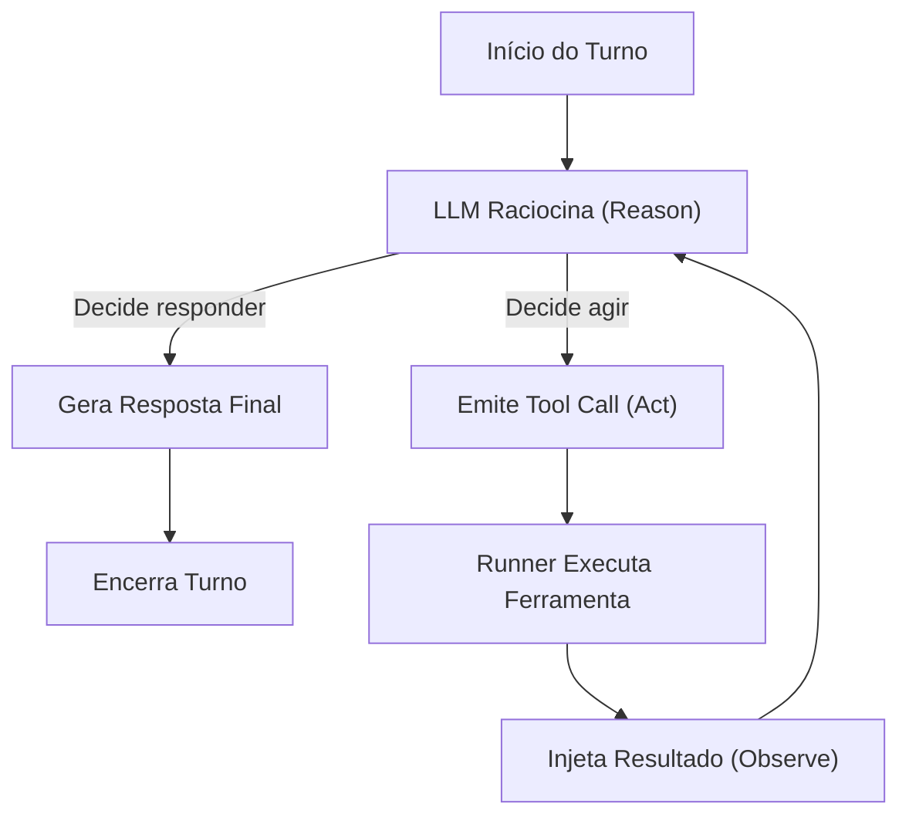
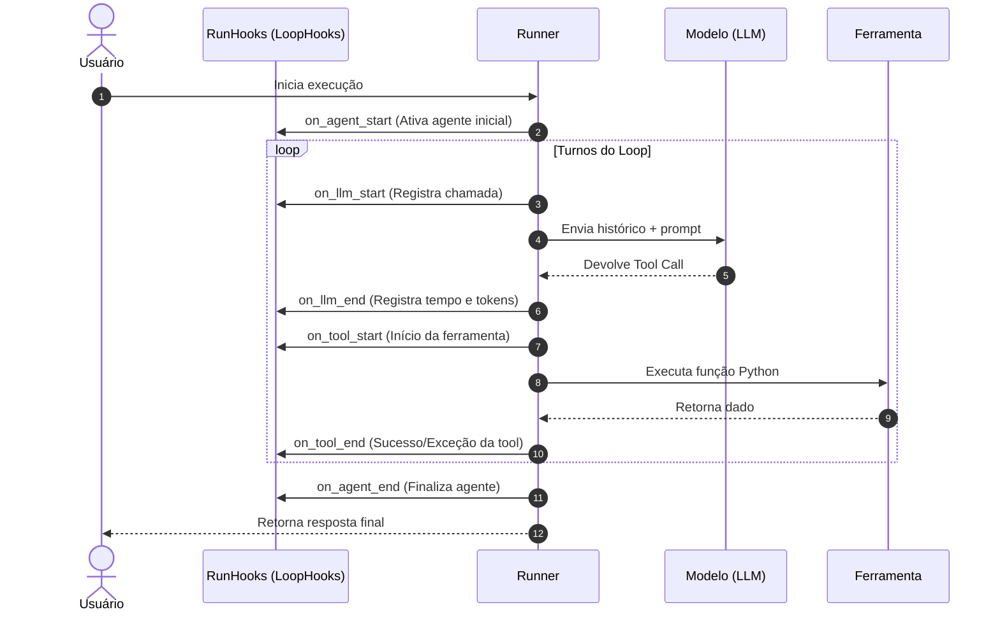
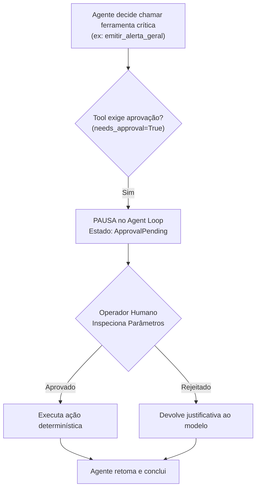

# Aula 3 — Engenharia de Agent Loops: Observabilidade, Resiliência e Controle Humano

Esta aula aprofunda a mecânica interna do ciclo de raciocínio e ação (**Agent Loop**) executado pelo `Runner`. O foco deixa de ser as ferramentas isoladas e passa a ser o controle operacional do ciclo: como **observar** cada turno via ganchos (*Hooks*), como estabelecer **critérios rigorosos de parada**, como sobreviver a falhas de rede com **retries e idempotência** e como implementar freios humanos (**Human-in-the-Loop**).

---

## 🏛️ Referencial Teórico

### 1. Anatomia do Agent Loop (Padrão ReAct)

Por padrão, a execução de um agente parece uma "caixa-preta": o usuário envia uma mensagem e recebe uma resposta. Nos bastidores, o `Runner` executa o padrão **ReAct (Reason + Act)**:
1. **Raciocínio (Reason)**: O LLM avalia a entrada e o histórico, decidindo se já possui informação suficiente para responder ou se precisa atuar no ambiente.
2. **Ação (Act)**: Se decidir agir, o modelo emite uma requisição estruturada de ferramenta (*Tool Call*).
3. **Observação (Observe)**: O `Runner` intercepta a chamada, executa o código Python da ferramenta e injeta o resultado como observação.
4. **Iteração**: O modelo reavalia a mesa com a nova evidência. O processo se repete até a conclusão ou estouro dos limites configurados.



---

### 2. Observabilidade com Hooks: `RunHooks` vs `AgentHooks`

Para monitorar métricas, custos e tempos de resposta, o SDK disponibiliza interceptadores assíncronos:
- **`RunHooks`**: Escuta o ciclo de vida global da execução. É ideal para registrar custos totais de tokens, métricas e auditoria fim a fim.
- **`AgentHooks`**: Escuta os eventos no escopo de um agente específico.



> **Atenção pedagógica crítica:** `on_agent_start` **não é contador de turnos**. Ele dispara apenas quando o agente ativo é inicializado ou quando ocorre um *handoff*. O verdadeiro contador de turnos e custos é o `on_llm_start`, que dispara a cada inferência realizada.

---

### 3. Critérios de Parada e Prevenção de Loops Infinitos

Agentes autônomos sem limites rígidos de parada podem entrar em loops recursivos infinitos, consumindo cotas orçamentárias. Esta aula implementa três salvaguardas:
1. **Limite de Turnos (`max_turns`)**: Corta a execução com `MaxTurnsExceeded` se o modelo insistir em chamar ferramentas além do teto operacional estipulado.
2. **Timeout Externo (`asyncio.wait_for`)**: Impede que requisições HTTP travadas em serviços legados congelem o processo.
3. **Critério Semântico de Sucesso**: Interrupção quando um schema Pydantic específico (`output_type`) é totalmente preenchido.

---

### 4. Resiliência: Retries, Backoff Exponencial e Idempotência

Redes reais sofrem com falhas transitórias (HTTP 429 *Rate Limit* e HTTP 503 *Service Unavailable*):
- **Backoff Exponencial**: Intervalo crescente entre tentativas consecutivas ($\text{delay} = \text{base} \times 2^{\text{tentativa}}$) com dispersão aleatória (*jitter*) para evitar colisões em massa.
- **Princípio da Idempotência (`agente_retry_idempotencia.py`)**: Em operações de escrita (ex.: registrar ocorrência policial ou debitar saldo), repetir a chamada sem uma chave de idempotência (`idempotency_key`) causaria duplicação de registros. O código demonstra como o agente deve validar se a transação já foi processada antes de refazer a escrita.

---

### 5. Human-in-the-Loop (HITL) com `needs_approval`

Para ações institucionais críticas (ex.: emissão de mandado, bloqueio judicial de bens ou alteração cadastral), a IA não deve ter autonomia irrestrita:
- A ferramenta é decorada com `needs_approval=True`.
- O `Runner` interrompe o loop e gera um estado pendente de autorização.
- Um operador humano avalia o contexto, inspeciona os parâmetros e aprova ou rejeita a execução.



---

## 📂 Inventário dos Scripts da Aula 3

| Arquivo | Conceito e Responsabilidade |
|---|---|
| [`agente_loop.py`](file:///home/phmcasimiro/Documentos/pos_graduacao/11_Sistem_MultiAgentes/aula3/agente_loop.py) | Implementação de `RunHooks` customizado para auditar o ciclo ReAct em tempo real. |
| [`agente_loop_max.py`](file:///home/phmcasimiro/Documentos/pos_graduacao/11_Sistem_MultiAgentes/aula3/agente_loop_max.py) | Demonstração do estouro de turnos com tratamento elegante de `MaxTurnsExceeded`. |
| [`agente_loop_stream.py`](file:///home/phmcasimiro/Documentos/pos_graduacao/11_Sistem_MultiAgentes/aula3/agente_loop_stream.py) | Observabilidade do loop com streaming de eventos e tokens ao vivo. |
| [`agente_hook1.py`](file:///home/phmcasimiro/Documentos/pos_graduacao/11_Sistem_MultiAgentes/aula3/agente_hook1.py) | Hook minimalista de contagem de chamadas ao LLM. |
| [`agente_hook2.py`](file:///home/phmcasimiro/Documentos/pos_graduacao/11_Sistem_MultiAgentes/aula3/agente_hook2.py) | Monitoramento de tempo de execução e latência por ferramenta. |
| [`agente_hook3.py`](file:///home/phmcasimiro/Documentos/pos_graduacao/11_Sistem_MultiAgentes/aula3/agente_hook3.py) | Interceptação e logging estruturado de parâmetros passados às ferramentas. |
| [`agente_hook4.py`](file:///home/phmcasimiro/Documentos/pos_graduacao/11_Sistem_MultiAgentes/aula3/agente_hook4.py) | Auditoria avançada de ciclo de vida com captura de exceções em tempo real. |
| [`agente_parada.py`](file:///home/phmcasimiro/Documentos/pos_graduacao/11_Sistem_MultiAgentes/aula3/agente_parada.py) | Critério de parada básico orientado a limite de iterações. |
| [`agente_parada_timeout.py`](file:///home/phmcasimiro/Documentos/pos_graduacao/11_Sistem_MultiAgentes/aula3/agente_parada_timeout.py) | Imposição de timeout externo assíncrono para proteção contra travamento. |
| [`agente_parada_dupla.py`](file:///home/phmcasimiro/Documentos/pos_graduacao/11_Sistem_MultiAgentes/aula3/agente_parada_dupla.py) | Combinação de salvaguarda dupla: timeout de relógio somado ao teto de turnos. |
| [`agente_retry.py`](file:///home/phmcasimiro/Documentos/pos_graduacao/11_Sistem_MultiAgentes/aula3/agente_retry.py) | Política de retries com backoff exponencial para chamadas de rede instáveis. |
| [`agente_retry_idempotencia.py`](file:///home/phmcasimiro/Documentos/pos_graduacao/11_Sistem_MultiAgentes/aula3/agente_retry_idempotencia.py) | Garantia de idempotência com chave única para evitar registros duplicados. |
| [`agente_aprovacao.py`](file:///home/phmcasimiro/Documentos/pos_graduacao/11_Sistem_MultiAgentes/aula3/agente_aprovacao.py) | Implementação de freio humano (*HITL*) através de `needs_approval`. |
| [`agente_human.py`](file:///home/phmcasimiro/Documentos/pos_graduacao/11_Sistem_MultiAgentes/aula3/agente_human.py) | Exemplo de consulta interativa ao operador humano durante o raciocínio. |
| [`agente_investigador.py`](file:///home/phmcasimiro/Documentos/pos_graduacao/11_Sistem_MultiAgentes/aula3/agente_investigador.py) | Síntese de engenharia: agente investigador encadeando ferramentas de forma autônoma. |

---

## 🛠️ Como Executar os Exemplos da Aula 3

```bash
# 1. Ativar o ambiente virtual
source venv/bin/activate

# 2. Executar o inspetor de loops com hooks
python -m aula3.agente_loop

# 3. Forçar e observar o tratamento de MaxTurnsExceeded
python -m aula3.agente_loop_max

# 4. Executar o fluxo com aprovação humana (HITL)
python -m aula3.agente_aprovacao

# 5. Executar o investigador autônomo com múltiplas ferramentas
python -m aula3.agente_investigador
```
