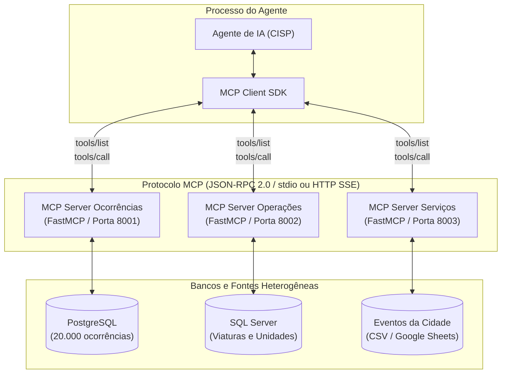

# Aula 5 — MCP (Model Context Protocol)

Cenário: CISP (Central Integrada de Segurança Pública, fictícia). Dados sintéticos.
Conceitos detalhados em [`aula5.md`](aula5.md). Este arquivo consolida a teoria, arquitetura e o roteiro de execução.

---

## 🏛️ Referencial Teórico: Por Que MCP?

Na Aula 4, aprendemos como um agente fala com **outro agente** (A2A). Na Aula 5, respondemos a uma pergunta complementar: **como um agente acessa dados e ferramentas externas sem acoplamento direto?**

### O Problema da Integração $N \times M$
Sem um protocolo padronizado, cada novo agente precisa de código customizado para cada banco ou API. Três agentes e três bancos resultam em $3 \times 3 = 9$ conectores. Com 50 agentes e 20 sistemas legados, o custo salta para até $1.000$ integrações.
O **Model Context Protocol (MCP)** resolve isso introduzindo uma camada cliente-servidor padronizada:
- **Redução para $N + M$**: Cada sistema expõe um único **MCP Server**; qualquer agente cliente compatível com MCP descobre e consome essas ferramentas dinamicamente através do protocolo.
- **Isolamento de Processos**: A ferramenta roda fora da memória do agente (via `stdio` ou `streamable HTTP`), com controle de permissões e auditoria independente.



---

## 1. Setup e Infraestrutura

### 1.1 Pré-requisitos

- Docker Desktop aberto.
- Venv da raiz ativada, com as dependências instaladas.
- Portas livres: 5434 (PostgreSQL), 1433 (SQL Server).
- 4 GB livres para as imagens Docker.

### 1.2 Subir os bancos

```bash
source venv/bin/activate      # a partir da raiz do curso
cd aula5
docker compose up -d postgres mssql
docker compose ps             # aguardar "healthy" nos dois
```

Use `127.0.0.1` no `.env` (`PG_HOST`, `MSSQL_HOST`), não `localhost` —
em algumas máquinas Windows `localhost` resolve para IPv6 e a conexão falha.

### 1.3 Schema do SQL Server

O Postgres aplica `banco-postgres/init.sql` sozinho (hook do container). O SQL
Server não tem esse hook:

```bash
docker cp banco-sqlserver/init.sql cisp-mssql:/tmp/init.sql
docker exec cisp-mssql /opt/mssql-tools18/bin/sqlcmd -S localhost -U sa -P "$MSSQL_PASSWORD" -C -i /tmp/init.sql
```

Rodar antes do seed do SQL Server — sem o schema, o erro é `Login failed for
user 'sa'`, mesmo com a senha certa (o banco `cisp_operacoes` não existe).

No Git Bash (Windows), prefixar o `docker exec` com `MSYS_NO_PATHCONV=1` se
aparecer erro de path tipo `C:/Program Files/Git/...`.

### 1.4 Massa de dados

```bash
python aula5/dados/seed_postgres.py
python aula5/dados/seed_sqlserver.py
```

Saída esperada: `OK: 20000 ocorrências inseridas...`, ranking de regiões com
Bravo/Foxtrot/Kilo no topo (hotspots intencionais — ver `dados/referencia.py`).

### 1.5 Acesso aos bancos pelo VS Code (opcional)

Extensões: `mtxr.sqltools`, `mtxr.sqltools-driver-pg`, `mtxr.sqltools-driver-mssql`.
Conexão via `settings.json` (Ctrl+Shift+P → Preferences: Open User Settings JSON):

```json
"sqltools.connections": [
  { "name": "CISP Ocorrências", "driver": "PostgreSQL", "server": "127.0.0.1",
    "port": 5434, "database": "cisp_ocorrencias", "username": "postgres",
    "password": "${PG_PASSWORD}" },
  { "name": "CISP Operações", "driver": "MSSQL", "server": "127.0.0.1",
    "port": 1433, "database": "cisp_operacoes", "username": "sa",
    "password": "${MSSQL_PASSWORD}",
    "mssqlOptions": { "encrypt": true, "trustServerCertificate": true } }
]
```

A partir daqui, os exemplos rodam direto (`cd aula5/exemplos/NN_xxx && python
arquivo.py`), com a venv da raiz ativada.

## 2. Bloco 1 — Por que MCP

### 2.1 Tool local, sem MCP

`exemplos/01_tool_local/agente_com_tool_local.py`. A tool é uma função Python
dentro do processo do agente — outro agente, em outro processo, não a alcança
sem copiar o código.

```bash
cd aula5/exemplos/01_tool_local
python agente_com_tool_local.py
```

### 2.2 Primeiro MCP Server

`exemplos/02_mcp_basico/server.py`. A tool passa a ser um processo separado.

```bash
cd aula5/exemplos/02_mcp_basico
python cliente.py
python cliente.py "Mostre ocorrências abertas da Região Alfa"
```

`python server.py` sozinho não imprime nada — fica esperando mensagens de um
cliente. Não é travamento.

### 2.3 MCP Inspector

Cliente MCP genérico, para testar um server sem precisar de um agente:

```bash
npx @modelcontextprotocol/inspector python server.py
```

Abrir a URL completa impressa no terminal (contém um token). Aba **Tools** →
**List Tools** → escolher a tool → preencher parâmetros → executar. Aba
**Protocol** mostra as mensagens trocadas; **Console**, o que o server
escreveu em `stderr`.

## 3. Bloco 2 — Schema e agente completo

### 3.1 Tool com parâmetros

`exemplos/03_mcp_parametros/server.py`. Mesma tool do bloco 1, agora recebendo
`regiao`, `periodo_dias`, `tipo`.

```bash
cd aula5/exemplos/03_mcp_parametros
npx @modelcontextprotocol/inspector python server.py
```

### 3.2 Agente + MCP: fluxo completo

`exemplos/04_agente_mcp/agente.py`. Usuário → Agente → MCP Client → MCP
Server → Tool → PostgreSQL, e volta pelo mesmo caminho.

```bash
cd aula5/exemplos/04_agente_mcp
python agente.py
```

## 4. Bloco 3 — Mais ferramentas

### 4.1 Um server, três tools

`exemplos/05_multiplas_tools/server.py`: `listar_tipos_ocorrencia()`,
`consultar_ocorrencias(...)`, `estatisticas_ocorrencias(periodo_dias,
agrupar_por)`.

```bash
cd aula5/exemplos/05_multiplas_tools
npx @modelcontextprotocol/inspector python server.py   # conferir as 3 tools
python agente.py
python agente.py "Roubos de Veículo na Região Kilo nos últimos 7 dias?"
```

## 5. Bloco 4 — Dois sistemas, dois bancos

### 5.1 Segundo banco: MCP Operações

`exemplos/06_mcp_operacoes/server.py`, sobre o SQL Server. Tool:
`consultar_unidades()`. Mesma estrutura de server do bloco 1; só o
`database.py` por trás muda.

```bash
cd aula5/exemplos/06_mcp_operacoes
npx @modelcontextprotocol/inspector python server.py
```

### 5.2 Dois MCP Servers ao mesmo tempo

`exemplos/07_multiplos_mcp/agente.py`. Sem JOIN entre os bancos — o
cruzamento é por nome da região, no próprio agente.

```bash
cd aula5/exemplos/07_multiplos_mcp
python agente.py
```

### 5.3 Pergunta que atravessa dois bancos

`exemplos/08_mcp_servicos/agente_com_servicos.py` e `agente_viaturas.py`.

```bash
cd aula5/exemplos/08_mcp_servicos
python agente_viaturas.py
```

## 6. Bloco 5 — MCP avançado

### 6.1 MCP sem banco

`mcp-servicos/server.py`: `calcular_distancia`, `encontrar_unidades_proximas`,
`calcular_indice_operacional` — cálculo puro, sem banco de dados atrás.

### 6.2 Composição livre

`exemplos/09_agente_complexo/agente.py`. Três MCP Servers finais
(`mcp-ocorrencias/`, `mcp-operacoes/`, `mcp-servicos/`), sem roteiro de
chamadas prescrito.

```bash
cd aula5/exemplos/09_agente_complexo
python agente.py
```

### 6.3 Segurança em tools de escrita

`exemplos/10_seguranca/server_seguro.py`: tool `alterar_status_ocorrencia`
com autorização por token, validação de status, um registro por chamada,
auditoria em `auditoria.log`.

```bash
cd aula5/exemplos/10_seguranca
python agente_seguranca.py
```

### 6.4 Observabilidade

`exemplos/11_observabilidade/agente_observavel.py`. Lê `resultado.new_items`
para listar cada tool chamada, o MCP Server de origem, os parâmetros e o
resultado — não depende do texto que o agente escreve sobre si mesmo.

```bash
cd aula5/exemplos/11_observabilidade
python agente_observavel.py
```

## 7. Bloco 6 — Planilha como fonte (opcional)

### 7.1 Planilha vira tool

`exemplos/12_mcp_eventos/server.py` + `planilha.py`. Tool `listar_eventos(regiao,
data_inicio, data_fim, tipo_evento)`, lendo `EVENTOS_CSV_URL` (planilha
publicada) com recuo para `dados/eventos.csv` local se a URL falhar ou não
estiver configurada.

```bash
cd aula5/exemplos/12_mcp_eventos
npx @modelcontextprotocol/inspector python server.py
```

### 7.2 Três fontes, um agente

`exemplos/13_tres_fontes/agente.py`: PostgreSQL (ocorrências) + SQL Server
(viaturas) + planilha (eventos), sem que nenhuma fonte conheça as outras.

```bash
cd aula5/exemplos/13_tres_fontes
python agente.py
python agente.py "Sua pergunta"
```

## 8. Produção: Streamable HTTP via Docker

Os MCP Servers passam a rodar como serviços HTTP independentes; o agente
conecta por rede, não mais por subprocesso. Profile `full` do
`docker-compose.yml`.

O `.env` fica na raiz do curso, não em `aula5/` — apontar explicitamente com
`--env-file ../.env`:

```bash
cd aula5
docker compose --env-file ../.env --profile full up -d --build mcp-ocorrencias mcp-operacoes mcp-servicos
docker compose --env-file ../.env --profile full run --rm agente python main.py "Quais as 3 regiões com mais ocorrências e quantas viaturas disponíveis as unidades responsáveis têm?"
```

Modo interativo (sem pergunta como argumento):

```bash
docker compose --env-file ../.env --profile full run --rm agente python main.py
```

Parar, voltando ao estado "só bancos":

```bash
docker compose --profile full stop mcp-ocorrencias mcp-operacoes mcp-servicos
```

## 9. Usando Ollama em vez de OpenAI/Zen

No `.env` da raiz:

```
PROVEDOR=ollama
OLLAMA_BASE_URL=http://localhost:11434/v1
OLLAMA_MODEL=llama3.2:3b
```

Para o container `agente` (Bloco 8): trocar `localhost` por
`host.docker.internal`, e passar `--env-file ../.env` (ou uma cópia local
com esse valor).

Se `PROVEDOR=zen` falhar em qualquer exemplo (403/402), o recuo para Ollama
é automático — ver `provedor.rodar()`/`rodar_async()` na raiz.

## 10. Troubleshooting

| Sintoma | Causa / solução |
| --- | --- |
| `python server.py` "não responde" | Normal em stdio — usar `cliente.py` ou o Inspector. |
| Erro de senha no Postgres com senha certa | Conferir a porta (5434) e `127.0.0.1` no `.env`. |
| Falha intermitente ao conectar | Trocar `localhost` por `127.0.0.1`. |
| `seed_sqlserver.py`: `Login failed for user 'sa'` | Rodar o `init.sql` antes (seção 1.3). |
| Container não fica `healthy` | `docker compose ps` e `docker logs <container>`. |
| `ModuleNotFoundError: provedor` | Falta `sys.path.insert(...)` no topo do arquivo. |
| Tool devolve 0 linhas | LLM inventou valor de filtro — listar os valores reais na docstring. |
| `IndexError` em `cur.execute` | SQL com `%` e params vazio — usar `params or None`. |
| `listar_eventos` vazio | `EVENTOS_CSV_URL` devolve HTML, não CSV — usar link de acesso público ou o CSV local. |
