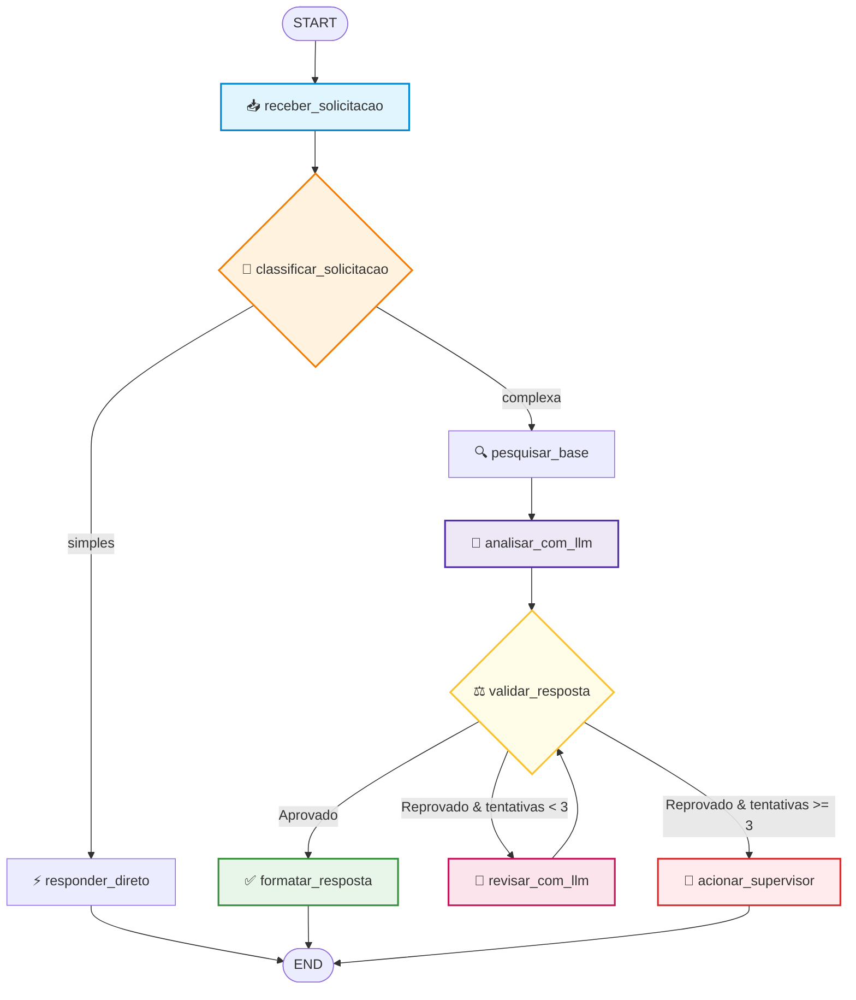
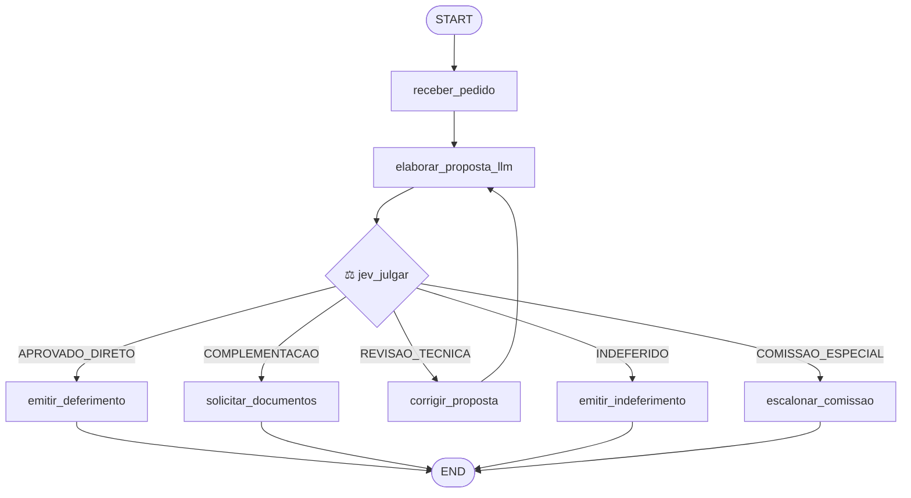
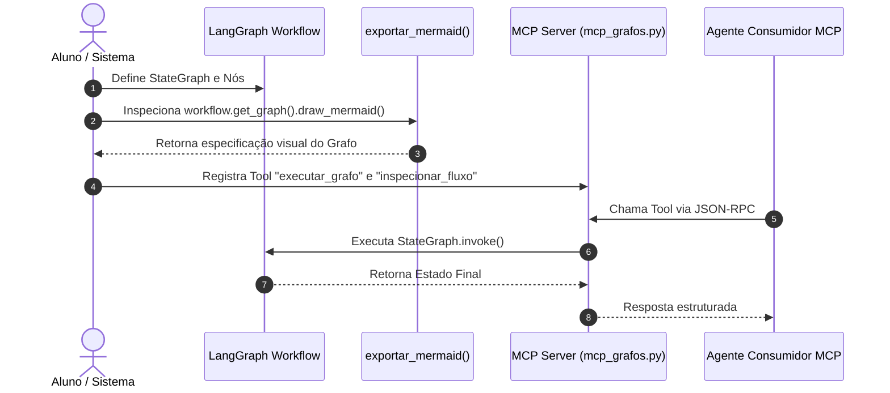

# Aula 6 — Modelagem de Sistemas Baseados em Grafos (LangGraph)

Cenário único da aula: um **sistema de análise e tratamento de solicitações governamentais**.
Um cidadão envia um pedido (ex.: *"Preciso saber como solicitar uma segunda via de um documento"*), e o sistema deve orquestrar recebimento, classificação, pesquisa na base de conhecimento, análise técnica, validação, revisão iterativa e emissão da resposta final.

> **Tese Central:** Um agente autônomo complexo não é um script sequencial nem um laço de repetição ad-hoc; ele é uma **máquina de estados que percorre um grafo direcionado de execução**.
>
> **O LangGraph permite transformar o fluxo cognitivo e operacional de agentes em um grafo explícito de estados, nós e transições condicionais governáveis.**

---

## 1. Referencial Teórico Aprofundado

### 1.1 Do Fluxo Procedural aos Grafos de Execução
Em sistemas tradicionais de IA, desenvolvedores frequentemente estruturam chamadas encadeadas em código imperativo:
```python
# Abordagem Frágil (Linear + Spaghettificação)
resp1 = classificar(entrada)
if resp1.categoria == "complexa":
    resp2 = pesquisar(resp1)
    while True:
        analise = analisar(resp2)
        if validar(analise):
            break
        corrigir(analise)
```
Essa abordagem falha rapidamente em escala por três motivos fundamentais:
1. **Ocultação do Fluxo:** As regras de transição ficam soterradas sob dezenas de `if`, `while` e blocos `try/except`. É impossível visualizar o processo sem inspecionar cada linha de código.
2. **Dispersão do Estado:** Variáveis intermediárias ficam espalhadas no escopo local, gerando efeitos colaterais e inconsistências quando etapas precisam ser reexecutadas.
3. **Rigidez e Falta de Auditoria:** Não há pontos padronizados para interceptação, checkpoints, inspeção de histórico ou reversão de passos.

### 1.2 Anatomia de um Grafo no LangGraph
O LangGraph modela a execução baseando-se na teoria dos grafos direcionados:

| Elemento | Definição Formal | No LangGraph |
|---|---|---|
| **Vértice / Nó (Node)** | Unidade atômica de computação. Uma função puramente orientada a estado: `f(Estado) -> DeltaEstado`. | `workflow.add_node("nome", funcao)` |
| **Aresta Direcionada (Edge)** | Transição estática e determinística de um nó $A$ para um nó $B$. | `workflow.add_edge("a", "b")` |
| **Aresta Condicional (Conditional Edge)** | Transição dinâmica avaliada por uma função roteadora baseada no estado atual: `R(Estado) -> ProximoNo`. | `workflow.add_conditional_edges("a", roteador)` |
| **Estado (State)** | Estrutura de dados imutável ou controlada (geralmente `TypedDict` ou Pydantic) compartilhada por todos os nós. | `class Estado(TypedDict): ...` |
| **Pontos de Entrada / Saída** | Nós sentinela que marcam o início e a conclusão do grafo. | `START` e `END` |

### 1.3 DAGs vs. Grafos com Ciclos
- **DAG (Directed Acyclic Graph):** Grafos direcionados acíclicos onde nenhuma aresta permite retornar a um nó antecedente. Ideais para pipelines de processamento paralelo (fan-out / fan-in) e etapas de enriquecimento de dados.
- **Grafos Cíclicos:** Grafos contendo laços de realimentação ($A \to B \to C \to A$). São indispensáveis em arquiteturas de agentes para:
  - Ciclos de auto-revisão (geração $\to$ crítica $\to$ correção);
  - Repetição com refinamento de prompts ou ferramentas;
  - Recuperação após respostas insatisfatórias ou dados incompletos.

### 1.4 Condições de Parada e Teoria da Confiabilidade
Em qualquer grafo com ciclos, a **terminação garantida** é um requisito crítico de segurança:
1. **Critério Funcional:** O estado atinge uma condição de aceite (ex.: `valido == True` ou `precisa_revisao == False`).
2. **Critério de Exaustão (Budget):** Um contador mantido no estado atinge o limite máximo (ex.: `tentativas >= MAX_TENTATIVAS`). O roteador desvia para um nó de contingência (`encaminhar_para_humano` ou `rejeicao_graciosa`).
3. **Recursion Limit (Safeguard):** O LangGraph impõe um teto estrito de profundidade recursiva (`recursion_limit`). Se o ciclo rodar infinitamente, a biblioteca interrompe a execução com `GraphRecursionError`.

---

## 2. Esquemas de Arquitetura

### 2.1 Topologia de Grafo Completo com Ciclo de Revisão (`10_agente_completo`)
Abaixo está o fluxo percorrido pela solicitação do cidadão, ilustrando nós de LLM, funções de validação e o laço cíclico de revisão:



### 2.2 Topologia de Decisões Tipadas com JEV (`desafio3`)
No Desafio 3, o LLM propõe a justificativa, mas o **JEV (Julgador Especializado em Validação)** toma a decisão de forma estritamente tipada com 5 ramificações de saída:



### 2.3 Topologia do Exercício Guiado: Grafo $\to$ Mermaid $\to$ MCP
O exercício guiado conecta a abstração do LangGraph à arquitetura de protocolos da Aula 5:



---

## 3. Estrutura de Diretórios da Aula 6

```text
aula6/
├── README.md               # Este guia completo de teoria, arquitetura e execução
├── aula-06.md              # Roteiro síncrono e perguntas pedagógicas da aula
├── provedor.py             # Adaptador unificado multi-modelo (Mock, OpenAI, Ollama, Claude)
├── requirements.txt        # Dependências (langgraph, langchain-core, etc.)
├── .env.example            # Template de variáveis de ambiente
├── exemplos/               # Progressão em 11 passos didáticos
│   ├── 01_fluxo_linear/    # Código sequencial clássico (evidencia os limites de A -> B -> C)
│   ├── 02_grafo_conceitual/# Mesma lógica modelada como dicionário de nós em Python puro
│   ├── 03_estado_compartilhado/ # Introdução ao TypedDict como contrato de dados
│   ├── 04_langgraph_basico/# Primeiro StateGraph compilado com START e END
│   ├── 05_multiplos_nos/   # Encadeamento de múltiplos nós com deltas parciais
│   ├── 06_fluxo_condicional/# Arestas condicionais com função roteadora
│   ├── 07_dag/             # Directed Acyclic Graph (bifurcação e convergência)
│   ├── 08_fluxo_ciclico/   # Introdução de laços de repetição e detecção de recursão
│   ├── 09_llm_no_grafo/    # Inserção de LLMs reais dentro dos nós do grafo
│   ├── 10_agente_completo/ # Agente orquestrado por grafo completo com ciclo de revisão
│   └── 11_grafo_real/      # Integração heterogênea: Nós com Funções, LLM, APIs e MCP
├── desafio/                # Desafio 1: Grafo de atendimento com urgência e pesquisa
├── desafio2/               # Desafio 2: Despacho inteligente de viaturas (MCP + LLM)
├── desafio3/               # Desafio 3: Decisões estritamente tipadas com o JEV (5 caminhos)
├── exercicio_guiado/       # Conversão do grafo em Mermaid e exposição via FastMCP Server
└── demo_cofre/             # Demonstração minimalista de estado, decisão, ciclo e parada
```

---

## 4. Evolução Didática dos Exemplos

| Exemplo | Conceito Central | O que demonstra |
|---|---|---|
| **01_fluxo_linear** | Rigidez do código procedural | Quatro funções chamadas em linha reta. Variáveis orfãs e ausência de desvios. |
| **02_grafo_conceitual** | Grafo sem bibliotecas externas | Implementação de grafo com dicionário `{no: funcao}` e laço `while`. Mostra que a teoria independe de framework. |
| **03_estado_compartilhado** | Contrato de dados centralizado | Uso de `TypedDict`. Nós leem o estado e produzem atualizações atômicas. |
| **04_langgraph_basico** | Fundação com LangGraph | `StateGraph`, `add_node`, `add_edge`, `compile()` e `invoke()`. |
| **05_multiplos_nos** | Imutabilidade e Deltas | Cada nó devolve apenas as chaves modificadas (`{"categoria": "..."}`), fundidas pelo LangGraph. |
| **06_fluxo_condicional** | Roteamento dinâmico | `add_conditional_edges()` direciona pedidos simples diretamente para a resposta e complexos para a pesquisa. |
| **07_dag** | Grafos acíclicos estruturados | Ramificação em tarefas independentes e posterior convergência em um nó integrador. |
| **08_fluxo_ciclico** | Laço de repetição e segurança | Demonstração do ciclo `validar -> revisar -> analisar`. Indução e tratamento de `GraphRecursionError`. |
| **09_llm_no_grafo** | Cognição desacoplada | Nós chamam o LLM encapsulado por `provedor.py`. O grafo orquestra; o LLM processa texto. |
| **10_agente_completo** | Agente de produção completo | Todas as peças integradas com ciclo de auto-revisão limitado e contingência. |
| **11_grafo_real** | Arquitetura mista | Nós heterogêneos executando código local, chamadas de LLM, requisições HTTP e Tools MCP. |

---

## 5. Prática e Desafios

### 5.1 Desafio 1: Análise de Solicitação de Atendimento
Localizado em `desafio/`. Implementa a triagem com prioridade:
- Solicitações urgentes desviam para tratamento emergencial.
- Validação técnica rigorosa com até 3 tentativas de revisão.
- Tratamento de solicitações cuja resposta inexiste na base de conhecimento.
```bash
python -m unittest desafio.test_desafio -v
```

### 5.2 Desafio 2: Despacho de Viaturas Policiais
Localizado em `desafio2/`. Combina LLM com Tools MCP de geolocalização e banco de viaturas:
- Extração de coordenadas da ocorrência.
- Consulta da viatura disponível mais próxima via MCP.
- Validação de regras operacionais em ciclo antes do despacho definitivo.
```bash
python desafio2/conferir.py
```

### 5.3 Desafio 3: Decisões Tipadas com o JEV
Localizado em `desafio3/`. O LLM é proibido de tomar decisões de negócio arbitrárias; ele apenas sintetiza argumentos:
- O **JEV (Julgador Especializado em Validação)** avalia a proposta e retorna um `ResultadoJulgamento` estritamente tipado.
- 5 transições de saída possíveis: deferimento, complementação, revisão técnica, indeferimento ou escalonamento para comissão especial.
```bash
python -m unittest desafio3.test_desafio3 -v
```

### 5.4 Exercício Guiado: Do Grafo ao Mermaid e ao MCP
Localizado em `exercicio_guiado/`:
1. `passo1_mermaid.py`: Compilação e extração textual da topologia do grafo via `draw_mermaid()`.
2. `mcp_grafos.py`: Servidor FastMCP que expõe o grafo compilado como uma ferramenta acessível por outros agentes.
```bash
python exercicio_guiado/test_guiado.py
```

---

## 6. Configuração e Execução

### 6.1 Configuração de Provedores (`.env`)
Copie o template e configure o modelo desejado:
```bash
cp .env.example .env
```

| `PROVEDOR` | Requisitos | Casos de Uso Recomendados |
|---|---|---|
| `mock` | Nenhuma chave ou internet | Exemplos 01 a 08 e testes unitários automatizados |
| `openai` | `OPENAI_API_KEY` preenchida | Exemplos 09, 10, 11 e Desafios 1, 2 e 3 |
| `ollama` | Ollama rodando localmente (`ollama run llama3.1`) | Ambientes offline ou de custo zero |
| `claude` | `ANTHROPIC_API_KEY` preenchida | Execuções alternativas com Anthropic Claude |

### 6.2 Comandos de Execução
```bash
# Ativação do ambiente virtual
source .venv/bin/activate  # Linux/Mac
# ou .venv\Scripts\Activate.ps1 no Windows

# Executar o fluxo conceitual inicial
python exemplos/01_fluxo_linear/main.py

# Executar o agente completo orquestrado pelo LangGraph
python exemplos/10_agente_completo/main.py

# Executar a demonstração do cofre de segurança
python demo_cofre/main.py
```
