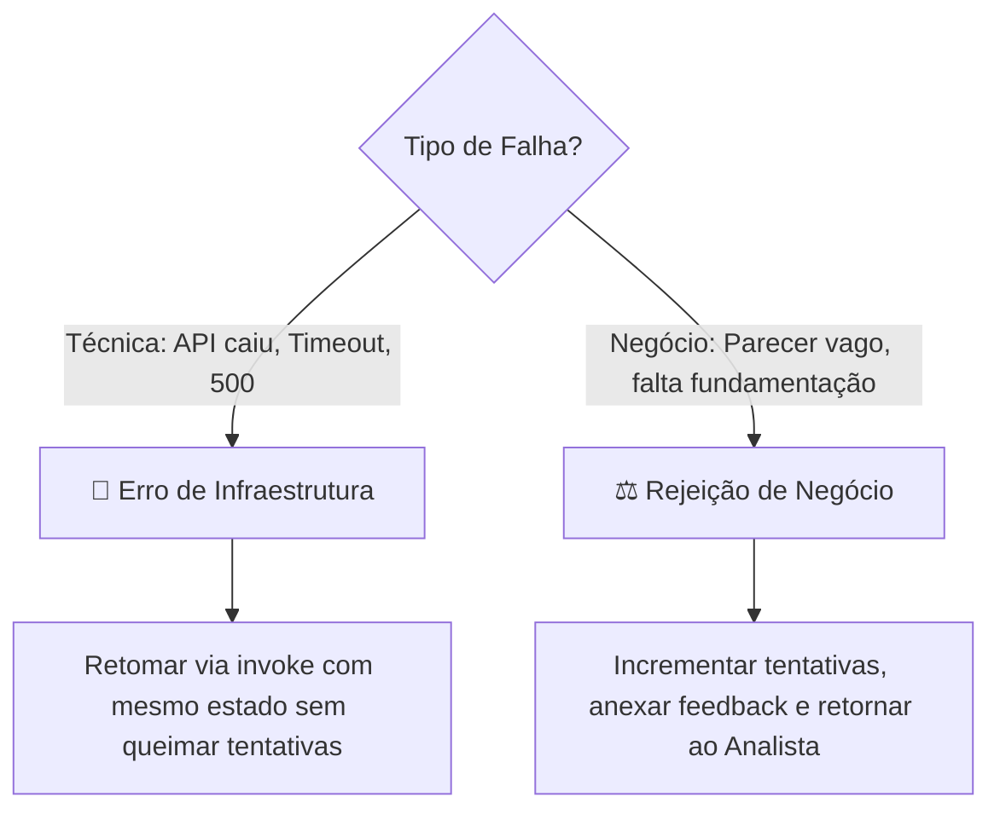
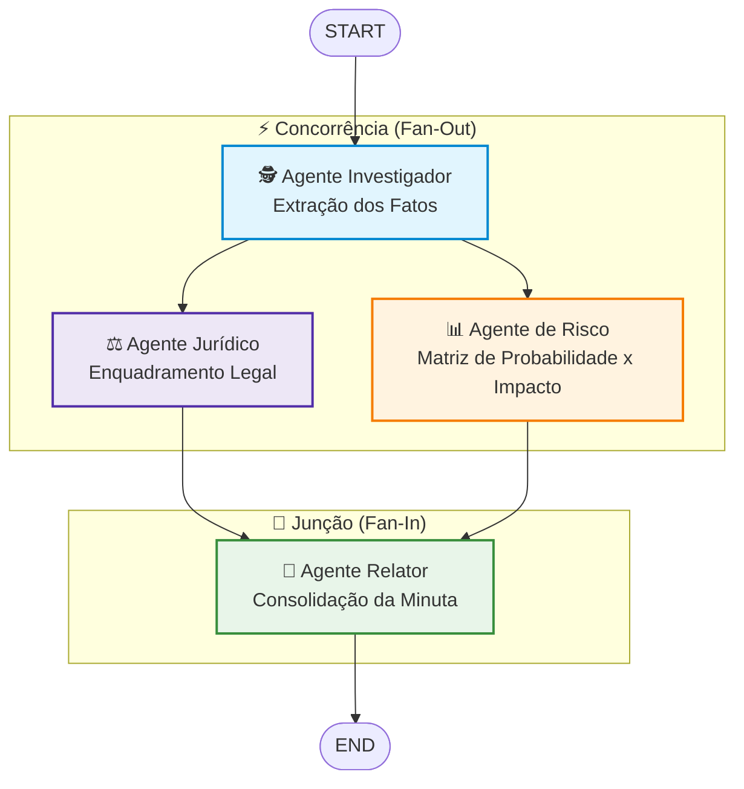
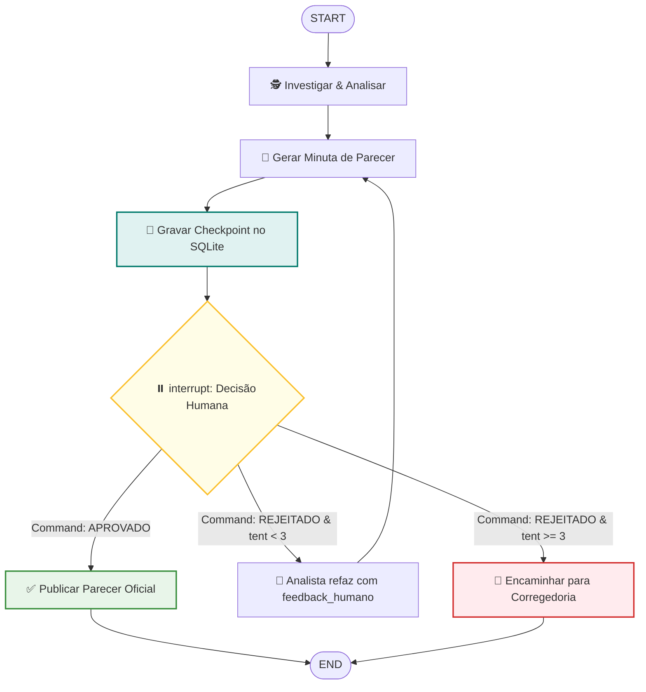
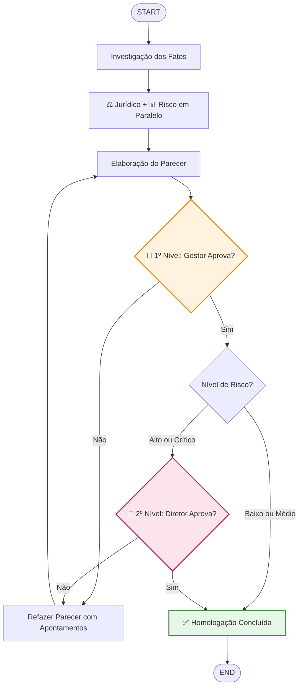

# Aula 7 — Sistemas Multiagentes, Persistência e Human-in-the-Loop

Cenário único da aula: uma **equipe especializada de agentes de inteligência fiscalizatória e auditoria** analisando denúncias sobre contratações públicas suspeitas (caso de estudo: *Pregão 045/2026*).
O sistema evolui de um agente generalista opaco para uma equipe colaborativa orientada a papéis, com estado gravado em banco de dados e **aprovação humana mandatória (Human-in-the-Loop)** em pontos críticos de decisão.

> **Tese Central:** Em ambientes corporativos e governamentais de alta criticidade, agentes autônomos não devem tomar decisões finais isoladamente. A arquitetura deve combinar **especialistas cooperativos**, **persistência de estado em checkpoints auditáveis** e **pausa assíncrona para intervenção e validação humana**.

---

## 1. Referencial Teórico Aprofundado

### 1.1 A Falência do Agente Generalista vs. Equipes de Especialistas
Ao utilizar um único agente monolítico para analisar uma denúncia completa:
- O agente mistura apuração de fatos empíricos, tipificação jurídica, cálculo de matriz de risco e recomendações punitivas.
- As saídas tornam-se prolixas, imprecisas e propensas a alucinações ("confabulações fáticas").
- Torna-se inviável atribuir responsabilidade ou testar isoladamente a conformidade jurídica sem reexecutar todo o processo.

**A Solução Multiagente Baseada em Especialistas:**
Cada agente atua sob o **Princípio da Responsabilidade Única (SRP)**:
1. **Agente Investigador:** Extrai exclusivamente fatos objetivos, datas, CNPJs e valores contidos na denúncia. Não emite juízo de valor.
2. **Agente Jurídico:** Recebe os fatos apurados e aplica a legislação pertinente (ex.: Lei 14.133/21, Lei 8.666/93).
3. **Agente de Risco:** Avalia a materialidade, relevância e impacto financeiro.
4. **Agente Relator/Analista:** Consolida os pareceres em uma minuta conclusiva de encaminhamento.

### 1.2 Estado de Execução vs. Memória de Longo Prazo

| Dimensão | Estado de Execução (*State*) | Memória de Longo Prazo (*Memory*) |
|---|---|---|
| **Definição** | Rascunho computacional ativo da execução corrente. | Base de conhecimento e histórico acumulado entre sessões. |
| **Tempo de Vida** | Vinculado ao ciclo de vida da transação ou `thread_id`. | Permanente em banco vetorial, relacional ou grafo de conhecimento. |
| **Conteúdo** | `denuncia`, `fatos`, `parecer_juridico`, `tentativas`. | Padrões de fraudes anteriores, jurisprudência de tribunais de contas. |
| **Analogia** | A pasta do processo aberta sobre a mesa do auditor. | O arquivo geral e a biblioteca jurídica do órgão. |

### 1.3 Teoria da Persistência e Checkpointers
Sistemas do mundo real não podem depender de memória volátil (RAM):
- Um parecer pode aguardar a assinatura de um gestor por **horas ou semanas**.
- Se o servidor reiniciar ou sofrer manutenção, a esteira não pode perder o progresso nem cobrar o modelo novamente.
- **Mecanismo de Checkpointing:** O `SqliteSaver` tira um snapshot criptografado/estruturado do estado após cada nó do grafo. Cada execução possui uma chave primária chamada `thread_id`.
- **Retomada Desacoplada (Inter-Processo):** O processo $A$ executa os nós automáticos e encerra. Dias depois, um processo $B$ (ex.: uma API FastAPI disparada pelo clique de um auditor em um portal web) invoca o grafo com o mesmo `thread_id` e restaura o fluxo exatamente de onde parou.

### 1.4 Human-in-the-Loop (HITL): `input()` vs. `interrupt()`
- **A Abordagem Ingênua (`input()`):** Bloqueia a thread do sistema operacional, impede a liberação de recursos, morre em reinicializações e é inviável em arquiteturas web distribuídas.
- **A Abordagem Robusta (`interrupt()` do LangGraph):**
  1. O nó executa e aciona `interrupt(pergunta)`.
  2. O LangGraph serializa o estado, grava o checkpoint no SQLite e **retorna a execução** para o chamador com uma estrutura especial `__interrupt__`.
  3. O processo Python é finalizado de forma limpa.
  4. Quando o humano decide, o sistema faz `invoke(Command(resume=resposta), config={"configurable": {"thread_id": id}})`.
  5. **Atenção à Idempotência:** Ao ser retomado, o nó que continha o `interrupt()` roda novamente desde o início. Portanto, ações de efeito colateral irreversível (ex.: envio de intimação ou débito em conta) **nunca** devem anteceder a chamada de interrupção.

### 1.5 Taxonomia das Paradas: Erro Técnico vs. Rejeição Humana



---

## 2. Esquemas de Arquitetura

### 2.1 Concorrência e Paralelismo: Fan-Out / Fan-In (`08_paralelismo`)
Quando duas análises dependem apenas dos fatos apurados pelo Investigador, elas podem rodar concorrentemente, reduzindo a latência total do sistema:



### 2.2 Máquina de Estados de Revisão e Human-in-the-Loop (`07_aprovacao_revisao`)
Fluxo completo com persistência SQLite, interrupção e ciclo limitado de revisão com feedback humano:



### 2.3 Aprovação em Dois Níveis (`desafio2`)
Arquitetura onde o Gestor sempre revisa a denúncia, mas o Diretor Geral é acionado dinamicamente apenas se o nível de risco ultrapassar o limiar crítico:



---

## 3. Estrutura de Diretórios da Aula 7

```text
aula7/
├── README.md               # Este guia completo de sistemas multiagentes, persistência e HITL
├── aula-07.md              # Material didático de perguntas e respostas teóricas
├── provedor.py             # Configuração do SDK de agentes (OpenAI ou Ollama)
├── agentes.py              # Definição modular dos especialistas (Investigador, Jurídico, etc.)
├── caso.py                 # Conjunto de denúncias fictícias com fatos verificáveis
├── prompts.py              # Prompts instrucionais estritos de cada especialista
├── requirements.txt        # Dependências (langgraph, langgraph-checkpoint-sqlite, openai-agents)
├── .env.example            # Template de configuração
├── exemplos/               # Progressão em 8 etapas práticas
│   ├── 01_agente_generalista/ # Limitações do agente monolítico
│   ├── 02_agentes_especializados/ # Separação dos agentes por responsabilidade
│   ├── 03_estado_compartilhado/ # Contrato TypedDict e distinção entre Estado e Memória
│   ├── 04_persistencia/    # SqliteSaver, thread_id e retomada entre processos distintos
│   ├── 05_equipe_multiagente/ # Orquestração da equipe através de nós do LangGraph
│   ├── 06_human_in_the_loop/ # Pausa com interrupt() e retomada via Command(resume=...)
│   ├── 07_aprovacao_revisao/ # Ciclo de rejeição com feedback, limite de loops e erro técnico
│   └── 08_paralelismo/     # Execução concorrente Fan-Out / Fan-In e medição de tempo
├── desafio/                # Desafio 1: Parecer com aprovação condicionada ao nível de risco
└── desafio2/               # Desafio 2: Análises em paralelo + aprovação escalonada em dois níveis
```

---

## 4. Catálogo dos Exemplos e Comandos

| Exemplo | O que demonstra | Comando Principal | Opções de Demonstração |
|---|---|---|---|
| **01** | Agente monolítico opaco | `python exemplos/01_agente_generalista/main.py` | Execução direta sem especialização |
| **02** | Especialistas sequenciais | `python exemplos/02_agentes_especializados/main.py` | Saídas independentes para cada papel |
| **03** | Estado compartilhado | `python exemplos/03_estado_compartilhado/main.py` | Inspeciona preenchimento incremental do `TypedDict` |
| **04** | Persistência com SQLite | `python exemplos/04_persistencia/main.py` | `--retomar` (retoma noutro processo)<br/>`--historico` (inspeciona checkpoints)<br/>`--auto` (execução completa contínua) |
| **05** | Grafo multiagente | `python exemplos/05_equipe_multiagente/main.py` | Exibe o log estruturado `[nó]` passo a passo |
| **06** | Pausa humana assíncrona | `python exemplos/06_human_in_the_loop/main.py` | `--simples` (modo `input()` síncrono)<br/>`--retomar sim` (outro processo responde)<br/>`--auto sim` (pausa e retoma localmente) |
| **07** | Ciclo de aprovação/revisão | `python exemplos/07_aprovacao_revisao/main.py` | `--auto nao,sim` (rejeição com feedback e posterior aprovação)<br/>`--falha-tecnica` (simula erro de API sem queimar tentativas) |
| **08** | Fan-out / Fan-in | `python exemplos/08_paralelismo/main.py` | Compara tempo em fila (~2s) vs paralelo (~1s) |

---

## 5. Desafios Práticos

### 5.1 Desafio 1: Aprovação Condicionada ao Risco
Localizado em `desafio/`. O sistema avalia a denúncia e inspeciona o parecer de risco:
- Denúncias de **baixo risco** são aprovadas e homologadas de forma 100% autônoma.
- Denúncias de **alto risco** acionam obrigatoriamente o checkpoint com `interrupt()`, solicitando validação humana.
```bash
python -m unittest desafio.test_desafio -v
```

### 5.2 Desafio 2: Especialistas Concorrentes e Duplo Nível de Alçada
Localizado em `desafio2/`. Reúne todos os conceitos avançados da aula:
- O Investigador extrai os fatos da denúncia.
- **Concorrência:** Jurídico e Risco processam em paralelo (Fan-Out).
- O Relator consolida os pareceres (Fan-In).
- **1º Nível:** O Gestor é consultado via `interrupt()`. Se rejeitar, o fluxo volta ao relator com feedback (máximo 3 tentativas).
- **2º Nível:** Se o Gestor aprovar e o risco for Alto/Crítico, uma segunda interrupção consulta o Diretor Geral antes da conclusão.
```bash
python -m unittest desafio2.test_desafio2 -v
```

---

## 6. Configuração e Infraestrutura

Todos os exemplos utilizam chamadas reais de LLM para demonstrar a variação natural e a robustez dos especialistas.

```bash
# Copiar o template de configuração
cp .env.example .env

# Configurar modelo desejado:
# Para OpenAI (padrão):
# OPENAI_API_KEY=sk-...
# PROVIDER=openai

# Para Ollama (local e gratuito):
# PROVIDER=ollama
# OLLAMA_MODEL=llama3.1
```

O banco de dados SQLite de checkpoints (`checkpoints.db`) é criado automaticamente no diretório local e é ignorado pelo Git para garantir segurança de dados e reprodutibilidade limpa.
