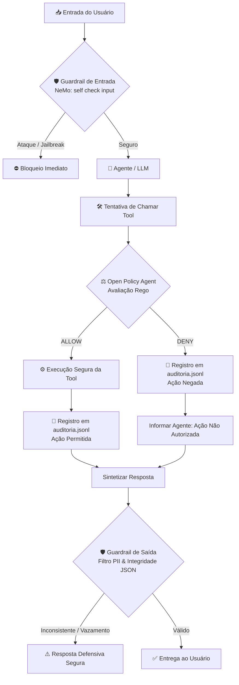
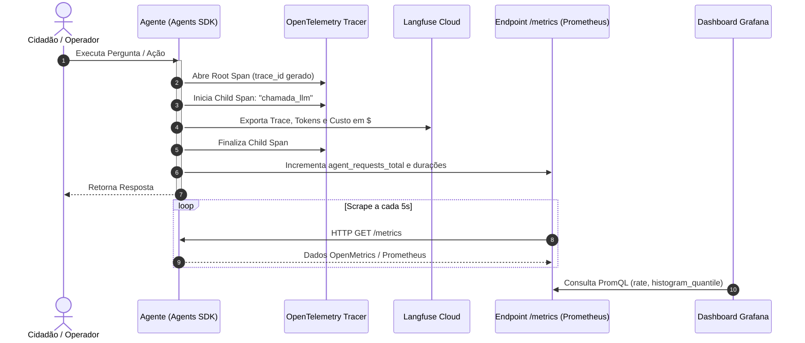
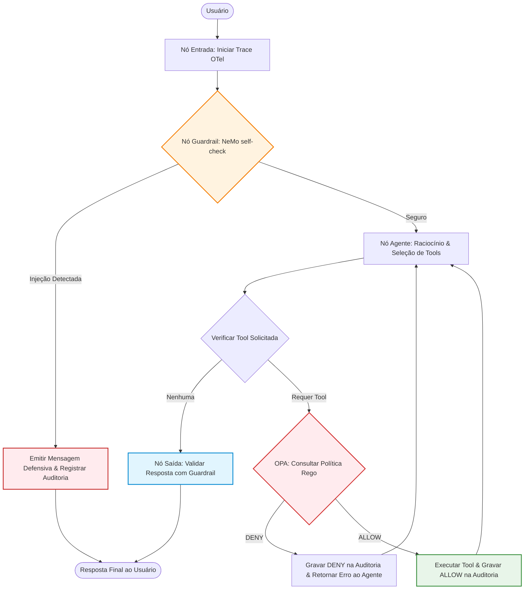

# Aula 8 — Observabilidade, Governança, Segurança e Auto-scaling

Laboratório prático de engenharia para sistemas de agentes autônomos em ambiente corporativo/governamental.
O roteiro demonstra como transformar um protótipo experimental de IA em um sistema **observável**, **mensurável**, **protegido contra ataques**, **autorizado por políticas externas**, **auditável**, **orquestrado** e **preparado para escala**.

```text
FUNCIONA → OBSERVAMOS → MEDIMOS → PROTEGEMOS → AUTORIZAMOS → AUDITAMOS → ORQUESTRAMOS → ESCALAMOS
```

> **Tese Central:** O LLM decide o que *gostaria* de fazer; a arquitetura de governança e as políticas decidem o que ele *pode* fazer.
> **Excessive Agency** e vulnerabilidades a **Prompt Injection** não são falhas de engenharia de prompt — são falhas estruturais de **arquitetura, autorização e falta de barreiras de proteção (guardrails)**.

---

## 1. Referencial Teórico Aprofundado

### 1.1 Os Pilares da Observabilidade de Agentes
Em sistemas tradicionais de microsserviços, a observabilidade baseia-se na tríade Traces, Métricas e Logs. Em sistemas orientados a agentes de IA, essa tríade é estendida com telemetria semântica de modelos:

| Pilar | Ferramenta Utilizada | O que responde no ciclo do agente |
|---|---|---|
| **Tracing Distribuído** | **OpenTelemetry (OTel)** | *"O que aconteceu nesta requisição específica?"* Árvore hierárquica de spans detalhando chamadas ao modelo, execuções de tools, latência e exceções. |
| **Métricas Temporais** | **Prometheus** | *"Quantas requisições ocorreram e qual o comportamento ao longo do tempo?"* Contadores de requisições, taxas de erro e histogramas de latência (`agent_requests_total`, `agent_request_duration_seconds_bucket`). |
| **Dashboards Operacionais**| **Grafana** | Visualização consolidada em tempo real de SLOs, tráfego e saúde do agente. |
| **LLM Observability** | **Langfuse** | Monitoramento especializado de IA: contagem exata de tokens de prompt e conclusão, custos financeiros em dólares por provedor/modelo, e inspeção visual do histórico de conversação. |
| **Auditoria Estruturada** | **Logs JSONL + `trace_id`**| *"Quem executou qual ação, em qual recurso, e qual foi a deliberação de política?"* Trilha imutável e irretratável para conformidade legal e perícia. |

### 1.2 Segurança e Defesa em Profundidade (*Defense in Depth*)



#### 1. Por que Prompts Não São Barreiras de Segurança
Instruções como *"Você é um assistente seguro e jamais deve revelar dados"* são facilmente contornadas através de técnicas avançadas de Prompt Injection (ataques de jailbreak, caracteres invisíveis, injeção indireta em documentos externos). A proteção de entrada deve ser executada por um **modelo avaliador independente (NeMo Guardrails)** antes do agente ter acesso à instrução maliciosa.

#### 2. Excessive Agency e Princípio do Privilégio Mínimo (*Least Privilege*)
Nunca exponha ao agente tools destrutivas (`excluir_usuario`, `formatar_disco`, `transferir_fundos`) a menos que estritamente necessário. O agente de consulta deve possuir apenas tools de leitura. O agente administrativo deve estar sujeito a alçadas adicionais.

#### 3. Autorização Desacoplada com Open Policy Agent (OPA)
- A regra de negócio e controle de acesso não deve ser embutida com `if` dentro da função Python da tool.
- As regras são escritas na linguagem declarativa **Rego** (`docker/opa/policy.rego`).
- **Arquitetura Fail-Closed:** Se o contêiner do OPA estiver inacessível, cair ou falhar, a ferramenta deve obrigatoriamente retornar `DENY`. Nenhuma ação privilegiada é executada na dúvida.
- Ações críticas (ex.: exclusão) exigem aprovação explícita registrada via Human-in-the-Loop.

#### 4. Fonte da Verdade: Auditoria vs. Alucinação
Em um incidente de segurança, o texto emitido pelo modelo é irrelevante para a perícia (*"Eu excluí o registro conforme solicitado"*). A **única verdade factual** é o registro estruturado de auditoria em `saidas/auditoria.jsonl`, contendo o carimbo de data/hora, o `trace_id` e a autorização emitida pelo OPA (`ALLOW` ou `DENY`).

### 1.3 Auto-scaling para Agentes de IA
A escalabilidade horizontal de agentes apresenta peculiaridades que a diferenciam de microsserviços tradicionais:
- **Gargalo de I/O de Terceiros:** A CPU do contêiner do agente permanece predominantemente ociosa aguardando a resposta das APIs de LLM. Escalonar puramente por métrica de CPU é ineficiente.
- **Métricas Efetivas de Disparo:**
  - Requisições concorrentes ativas em andamento por réplica (*gauge*).
  - Latência de percentil 95 ($p_{95}$).
- **State Offloading:** Para subir $N$ cópias de um agente atrás de um Load Balancer, a aplicação deve ser completamente *stateless*. Memórias de sessão e checkpoints de grafos devem residir fora do processo (Redis, PostgreSQL ou SQLite distribuído).
- **Proteção contra Sobrecarga (Backpressure e Rate Limiting):** Provedores de LLM impõem tetos de Tokens por Minuto (TPM) e Requisições por Minuto (RPM). Um aumento descontrolado de pods pode atingir os limites da conta, provocando erros HTTP 429 em cascata. O auto-scaler deve cooperar com filas e circuit breakers.

---

## 2. Esquemas de Arquitetura

### 2.1 Pipeline de Telemetria e Observabilidade
Como os dados transitam desde a execução da tool até a visualização no Grafana e Langfuse:



### 2.2 Topologia do Agente Seguro Integrado (`exemplos/11_integracao`)
Orquestração completa combinando LangGraph, NeMo, OPA, OTel e Auditoria:



---

## 3. Estrutura de Diretórios da Aula 8

```text
aula8/
├── README.md               # Este guia completo de governança, observabilidade e segurança
├── verificar_ambiente.py   # Script de pré-voo que valida Python, Docker, chaves e serviços
├── requirements.txt        # Dependências do laboratório
├── .env.example            # Variáveis de ambiente (OpenAI, Ollama, Langfuse)
├── CHECKLIST_FINAL.md      # Roteiro de verificação para o instrutor e alunos
├── base/                   # Componentes centrais reutilizáveis
│   ├── provedor.py         # Configuração dos modelos (OpenAI / Ollama)
│   └── guardrails.py       # Inicialização do NeMo Guardrails
├── observabilidade/        # Módulos de telemetria
│   ├── tracing.py          # Instrumentação com OpenTelemetry SDK
│   └── metricas.py         # Servidor de métricas Prometheus (/metrics)
├── seguranca/              # Módulos de governança e segurança
│   ├── opa.py              # Cliente HTTP para consulta ao Open Policy Agent
│   └── auditoria.py        # Registro estruturado de eventos em formato JSONL
├── docker/                 # Infraestrutura de contêineres locais
│   ├── docker-compose.yml  # Definição dos serviços Prometheus, Grafana e OPA
│   ├── prometheus.yml      # Configuração de scraping do alvo do agente (porta 8000)
│   ├── grafana/            # Provisionamento automático e dashboards pré-carregados
│   └── opa/policy.rego     # Regras de autorização declarativas escritas em Rego
├── exemplos/               # Progressão prática dividida em 11 passos
│   ├── 01_agente_basico/   # Execução básica do OpenAI Agents SDK
│   ├── 02_agente_tool/     # Agente acionando ferramenta de consulta climática
│   ├── 03_observabilidade/ # Evolução: Passo 1 (Trace), Passo 2 (Langfuse), Passo 3 (Métricas)
│   ├── 04_prompt_injection/# Demonstração do ataque e mitigação com NeMo Guardrails
│   ├── 05_guardrail_saida/ # Validação estrita de formato e bloqueio de vazamentos
│   ├── 06_excessive_agency/# Demonstração do perigo de tools irrestritas e Least Privilege
│   ├── 07_opa/             # Desacoplamento de autorização com OPA e aprovação humana
│   ├── 08_auditoria/       # Geração do log estruturado imutável com trace_id
│   ├── 09_langgraph/       # Visualização do fluxo explícito via Mermaid
│   ├── 10_agentes_e_grafo/ # Integração de agentes como nós de um grafo
│   └── 11_integracao/      # Arquitetura completa: Agente Seguro em produção
├── testes/                 # Bateria de testes automatizados com pytest
│   ├── test_guardrails.py  # Testes de bloqueio de jailbreak e validação de saída
│   ├── test_opa_auditoria.py# Testes de avaliação de política e garantia fail-closed
│   └── test_integracao.py  # Teste ponta a ponta do pipeline completo
├── saidas/                 # Artefatos gerados em tempo de execução (auditoria.jsonl)
└── docs/auto_scaling.md    # Referência teórica de arquitetura para auto-scaling no Kubernetes
```

---

## 4. Ordem Didática dos Exemplos e Comandos

Cada exemplo possui uma pasta `1_codigo_pronto/` (demonstra a vulnerabilidade ou problema) e uma pasta `2_solucao/` (implementa a solução robusta).

| # | Tema Principal | Arquivo de Execução | Conceito em Demonstração |
|---|---|---|---|
| **01** | Agente Básico | `python exemplos/01_agente_basico/main.py` | Validação do SDK e ciclo fundamental de execução |
| **02** | Agente + Tool | `python exemplos/02_agente_tool/main.py` | Modelo decidindo autonomamente quando disparar a tool |
| **03** | Traces OTel | `python exemplos/03_observabilidade/2_solucao/passo1_trace.py` | Geração de árvore de spans hierárquica no terminal |
| **03** | Langfuse | `python exemplos/03_observabilidade/2_solucao/passo2_langfuse.py` | Exportação de tokens, latência e custo financeiro para a nuvem |
| **03** | Métricas Prometheus | `python exemplos/03_observabilidade/2_solucao/passo3_metricas.py` | Exposição de métricas OpenMetrics na porta 8000 |
| **04** | Prompt Injection | `python exemplos/04_prompt_injection/2_solucao/passo2_agente_protegido.py` | Bloqueio de injeção direta usando NeMo `self check input` |
| **05** | Guardrail de Saída | `python exemplos/05_guardrail_saida/2_solucao/passo2_corrige.py` | Sanitização e validação de formato antes da emissão |
| **06** | Excessive Agency | `python exemplos/06_excessive_agency/2_solucao/passo1_privilegio_minimo.py` | Remoção de tools perigosas (Privilégio Mínimo) |
| **07** | OPA | `python exemplos/07_opa/2_solucao/passo3_aprovacao_humana.py` | Decisão externa via Rego; exclusão exige aprovação humana |
| **08** | Auditoria | `python exemplos/08_auditoria/2_solucao/passo1_registrar.py` | Gravação imutável em `saidas/auditoria.jsonl` com `trace_id` |
| **09** | LangGraph | `python exemplos/09_langgraph/1_codigo_pronto/main.py` | Modelagem explícita de fluxo e geração de Mermaid |
| **10** | Agentes no Grafo | `python exemplos/10_agentes_e_grafo/2_solucao/passo1_grafo_agentes.py` | Múltiplos agentes especializados integrados em nós |
| **11** | Agente Seguro | `python exemplos/11_integracao/2_solucao/agent_seguro.py` | **Integração total:** Entrada $\to$ NeMo $\to$ OPA $\to$ Auditoria $\to$ Saída |

---

## 5. Infraestrutura Docker e Painéis

A pasta `docker/` provê a stack completa de observabilidade e autorização local:

```bash
cd docker
docker compose up -d
docker compose ps
```

| Serviço | URL | Credenciais / Notas |
|---|---|---|
| **Prometheus** | `http://localhost:9090` | Efetua scraping do agente a cada 5s no endpoint `:8000/metrics` |
| **Grafana** | `http://localhost:3000` | Usuário: `admin` / Senha: `admin`. Dashboard pré-configurado |
| **Open Policy Agent (OPA)**| `http://localhost:8181` | Servidor de políticas. Para recarregar regras: `docker compose restart opa` |

---

## 6. Testes Automatizados e Garantia da Qualidade

A suíte de testes do repositório valida os controles de governança de forma determinística:

```bash
# Rodar testes rápidos de política e guardrails (sem chamar LLM)
python -m pytest -m "not llm"

# Rodar todos os testes (incluindo testes ponta a ponta com LLM real)
python -m pytest
```

| Arquivo de Teste | Garantia Comprovada |
|---|---|
| `test_guardrails.py` | `BLOCKED` para ataques adversariais; `PASSED` para consultas válidas; saídas inconsistentes interceptadas. |
| `test_opa_auditoria.py` | Respostas `ALLOW` e `DENY` corretas de acordo com a política Rego; garantia *fail-closed* se o OPA cair. |
| `test_integracao.py` | Fluxo completo do `agent_seguro.py`: injeções bloqueadas na entrada, comandos negados pelo OPA e auditoria íntegra. |
